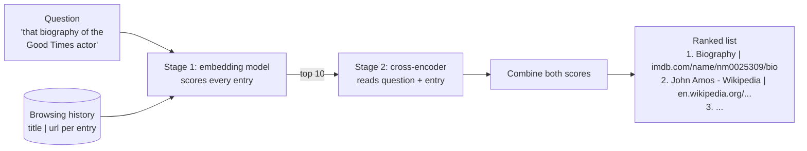
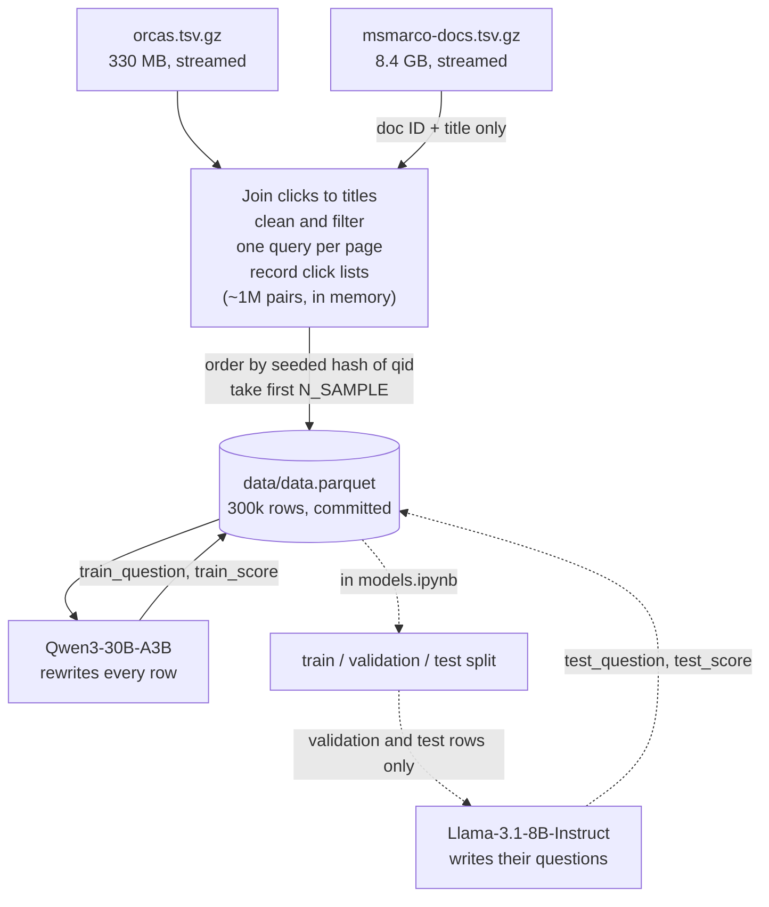

# Breadcrumbs History Retriever

A retriever for browsing history. A person asks a conversational question, such as "that biography of the Good Times actor I looked at", and the system ranks the pages in their history so the one they mean comes first.

Browser history search matches the literal words typed against page titles and URLs. People asking about their history describe a page in their own words and rarely remember its exact title. To train a retriever for such questions, the project turns real search clicks into conversational questions with an LLM. It then fine-tunes embedding models and rerankers on them and compares them with keyword search and off-the-shelf models on held-out questions.

The project runs locally in Jupyter notebooks on an Apple Silicon Mac. It is non-commercial coursework for CS 371N (Natural Language Processing).

> **Status:** done. Every approach was scored once on the 2,000 test questions. The write-up, with figures, is [`report.md`](report.md); the full tables are in [`results/scores.md`](results/scores.md).

## Research question and hypotheses

**When people ask about their browsing history in their own words, what is the best way to build and fine-tune a retriever so it returns the page they mean?**

- **H1. Fine-tuning helps.** An embedding model fine-tuned on search clicks that an LLM rewrote into conversational questions finds the right page more often than keyword search (BM25) and than the same model without fine-tuning, on questions written by a different LLM.
- **H2. The gain replicates.** Fine-tuning also helps a second embedding model.
- **H3. A reranker fixes the ordering problem.** After fine-tuning, the right page is usually near the top but not first. A cross-encoder fine-tuned on the embedding model's own mistakes, reordering its top 10, puts it first more often.

All three are supported; the evidence is in [Results](#results) and Section 1 of [`report.md`](report.md). Rewriting search queries into questions is only how the project produces training data. It is a means, not the subject of the study.

## Result

The final model puts the right page first for **83.2%** of the 2,000 Llama-written test questions (95% CI 81.6–84.7), with MRR 0.890. It is a fine-tuned `snowflake-arctic-embed-l-v2.0` embedding model, with a fine-tuned `gte-reranker-modernbert-base` cross-encoder reordering its top 10. Keyword search (BM25) manages 56.1%.

## How it works

A history entry is the title and URL a browser saves for each visit. Browsers do not store page text, so the system never uses page bodies. The model reads each entry as one string:

```text
Biography | imdb.com/name/nm0025309/bio
```

The retriever has two stages:
- **Embedding model:** embeds every entry once, scores all of them against the question by vector similarity, and keeps the top 10.
- **Reranker:** a cross-encoder reads the question and each of those 10 entries together.

The final score combines both: `w · z(embedding) + z(reranker)`, where z standardises each model's scores within the 10 and `w` is fitted on held-out training rows.



### The approach, step by step

| Step | Approach | Why we tried it | Test Recall@1 |
| --- | --- | --- | --- |
| 1 | Keyword search (BM25, k1 = 1.2, b = 0.75) | Baseline: a stronger version of the literal matching in Chrome's history search | 0.561 |
| 2 | Embedding model, off the shelf | Matches meaning, not words | 0.785 |
| 3 | The same model, fine-tuned on the rewritten questions | **The method under test (H1)** | 0.806 |
| 4 | 3 + fine-tuned reranker on its top 10 | Step 3 has the answer in its top 10 for 98% of questions but first for only 81% (H3) | **0.832** |

Also tried:
- Merging BM25's ranking with step 3's (reciprocal rank fusion): 0.682, worse than step 3 alone.
- The reranker without fine-tuning: 0.819.

**Choosing the models.** For each stage we fine-tuned several widely used open models and kept the one with the best validation Recall@1. Nothing was chosen on test.
- **Embedding models:** bge-small, e5-large-v2, mxbai-embed-large-v1 and snowflake-arctic-embed-l-v2.0. Snowflake was chosen.
- **Rerankers:** bge-reranker-v2-m3 and gte-reranker-modernbert-base. gte was chosen.

Fine-tuning improved every embedding model (H2). Small models such as bge-small (33M) plateaued near 71% validation Recall@1, so the final model is a larger one (568M).

## Data

### Sources

| File | Contents | Size | Use |
| --- | --- | --- | --- |
| `orcas.tsv.gz` | `qid, query, did, url` for about 18.8 million Bing searches and the page clicked for each | 330 MB | Searches, clicked pages, URLs |
| `msmarco-docs.tsv.gz` | `did, url, title, body` for about 3.2 million web pages | 8.4 GB | Page titles only |

Both come from [MS MARCO](https://microsoft.github.io/msmarco/) and are licensed for non-commercial research use only. Work that uses ORCAS cites Craswell et al. (2020).

### Data flow



Only `data/data.parquet` is saved. Both source files are read straight from their URLs and decompressed in memory.

1. **Stream ORCAS**, about one minute.
2. **Stream MS MARCO titles.** The 8.4 GB file is decompressed as it downloads, keeping only the document ID and title of pages clicked in ORCAS. This takes about 15–20 minutes.
3. **Join each click to its page title, then clean:**
   - Drop queries and titles with no letters or digits.
   - Drop titles over 20 words, which are usually scraped page text rather than real titles.
   - Drop queries with non-ASCII characters, which are mostly non-English.
   - Keep one clicked page per query as its answer, then one query per page, so no page answers two different questions.
   - Normalize URLs: remove the scheme, a leading `www.`, and trailing slashes.
4. **Record click lists.** For every query, `clicked_dids` lists every page the searcher clicked, including the answer.
5. **Sample.** Order the pairs by a seeded hash of each `qid` and take the first `N_SAMPLE` rows (300,000), then write `data/data.parquet`. A row's position depends only on its own `qid`, so a larger sample always contains a smaller one.
6. **Rewrite with Qwen.** Qwen3-30B-A3B rewrites every sampled search into a conversational question, filling `train_question` and `train_score`. The run saves progress every few thousand rows and resumes where it stopped.

Llama-3.1-8B-Instruct writes the validation and test questions in `models.ipynb`, after the split.

**One neutral prompt for both writers.** The first prompt banned copying three or more consecutive title words and asked for loose descriptions. Those rules make questions avoid the page's own words, which handicaps BM25 by design. All final questions, for training, validation and test, were regenerated without them.

### Example row

```text
qid             4905047
query           john amos
answer_did      D2377650
title           Biography
url             imdb.com/name/nm0025309/bio
clicked_dids    [D2377650, D512904]
train_question  that biography of the Good Times actor I looked at        (Qwen)
train_score     -0.082
test_question   (empty unless this row is in validation or test)          (Llama)
```

The correct answer is the page the searcher clicked. Models never see `answer_did`; it is used only to build training pairs and to score rankings.

### Schema of `data/data.parquet`

One row per sampled query.

| Column | Type | Filled by | Meaning |
| --- | --- | --- | --- |
| `qid` | string | Sampling | ORCAS query ID |
| `query` | string | Sampling | Original search query |
| `answer_did` | string | Sampling | **The correct answer**: MS MARCO ID of the clicked page |
| `title` | string | Sampling | Answer page's title |
| `url` | string | Sampling | Answer page's normalized URL |
| `clicked_dids` | list of strings | Sampling | Every page clicked for this search, including `answer_did` |
| `train_question` | string | Qwen run | Conversational rewrite, used when the row is in training |
| `train_score` | float | Qwen run | Average token log-probability, used to filter training rows |
| `test_question` | string, empty outside validation and test | `models.ipynb` | Llama question |
| `test_score` | float, empty outside validation and test | `models.ipynb` | Llama's average token log-probability; a diagnostic, never a filter |

Guarantees checked before every save:

- `qid` and `answer_did` are each unique.
- `answer_did` is always in `clicked_dids`.
- `title` and `url` are never blank.

The entry string `title | url` is built in code and not stored. The URL often carries what the title lacks: in an earlier 152,500-row sample, 30% of titles were two words or fewer and 10% were identical to another page's title. "Biography" appeared 253 times, on IMDb pages whose actor is identified only in the URL.

### Why two LLMs

If one model wrote both training and test questions, a fine-tuned retriever could score well by learning that model's phrasing instead of the task. Test questions therefore come from a different model family, following BEIR (Thakur et al., 2021). Each row is either training or test, never both. The same test pages are also asked by Qwen. A small gap between Qwen and Llama scores shows a model learned the task, not Qwen's style.

## Training

### Preparing training rows

1. **Split** by query: 297,500 training, 500 validation and 2,000 test rows.
2. **Drop training rows** whose `answer_did` appears in any validation or test row's `clicked_dids`.
3. **Filter training rows:**
   - drop rewrites containing CJK characters;
   - drop duplicate questions;
   - drop the lowest 10% by `train_score` (`drop10`, chosen on validation);
   - cap any three-word opening at 10% of questions.
4. **Add the original search queries** as extra rows (30% of the question rows), so the model still handles short searches.
5. **Mine one hard negative per question:** the top BM25 match of the *answer page's own entry* over training entries, skipping the row's `clicked_dids`. This is the same way evaluation histories are built. The original recipe, the top BM25 match of the question, scored 1.8 points lower on validation.

The models trained on the first 50,000 question rows. Training snowflake on all 233k usable rows gained only 0.4 points, below the 0.5-point bar set in advance.

### One training example

```text
question  that biography of the Good Times actor I looked at
positive  Biography | imdb.com/name/nm0025309/bio                  ← answer_did
negative  John Amos - Wikipedia | en.wikipedia.org/wiki/John_Amos  ← look-alike hard negative
```

The hard negative looks right but is wrong. Random pages from the batch are easy to reject on topic alone, while test histories contain same-topic and near-duplicate pages. Excluding every page in `clicked_dids` keeps pages the searcher actually opened from being taught as wrong. Every other question's positive and negative in the batch act as extra wrong answers (in-batch negatives).

### Embedding model

| Setting | Value |
| --- | --- |
| Base model | `Snowflake/snowflake-arctic-embed-l-v2.0` (568M) |
| Loss | `MultipleNegativesRankingLoss` (sentence-transformers) |
| Batch size | 128 |
| Learning rate | 2e-5, 10% warmup |
| Epochs | 1 |
| Max length | 64 tokens |
| Query prompt | The model's own query prompt, stored in its config |
| Precision | bf16 |
| Seeds | 3 |

### Reranker

- **Base model:** `Alibaba-NLP/gte-reranker-modernbert-base` (149M), trained as a sentence-transformers CrossEncoder on 50k rows.
- **Training data mirrors evaluation.** Each row gets a pseudo-history built like the test ones: the answer, 100 BM25 look-alikes and 99 random training pages. The fine-tuned bi-encoder ranks it, and its 7 top non-answer pages become hard negatives.
- **Loss:** `MultipleNegativesRankingLoss` for cross-encoders, a softmax over the positive, its 7 hard negatives and 4 in-batch negatives.
- **Settings:** 1 epoch, bf16, 128 tokens for question and entry together, 3 seeds.
- **Fusion weight:** chosen from a 14-value grid on 1,000 held-out training rows, never on validation.

## Evaluation

Each validation or test question ranks its own 200-entry history: the answer, 100 BM25 look-alikes of the answer's entry (same-topic and near-duplicate pages) and 99 random pages. No other page in the question's `clicked_dids` enters its history, so exactly one entry is correct. All conditions rank the same histories (`data/histories.parquet`).

| Metric | Meaning with one correct entry |
| --- | --- |
| Recall@1 (primary) | Is the answer ranked first? |
| Recall@k, k = 5, 10, 20, 50, 100 | Is the answer in the top k? For the embedding model, Recall@10 is the reranker's ceiling |
| MRR | 1 ÷ the answer's rank, averaged over questions; breaks Recall@1 ties |

- **Statistics:**
  - Fine-tuned models use 3 seeds.
  - Each approach gets a 95% bootstrap confidence interval: 10,000 resamples of questions, with seeds averaged per question.
  - Differences between approaches use a paired bootstrap on the same resamples.
- **Validation only:** all choices (data size, hard negatives, models, fusion weight, reranker k) are made on validation or on held-out training rows. Test is scored once.
- **Validation noise:** with 500 questions, Recall@1 has a standard error of about 2 points, so validation differences under about 3 points are treated as noise.

### Hypotheses and evidence

| Hypothesis | Evidence (test, 2,000 questions; 95% paired-bootstrap CI) | Verdict |
| --- | --- | --- |
| H1 | Fine-tuned vs BM25: Recall@1 0.806 vs 0.561 (+24.5 [+22.3, +26.7]). Vs the same model off the shelf: 0.806 vs 0.785 (+2.0 [+0.7, +3.4]); MRR 0.874 vs 0.855 | Supported |
| H2 | Validation Recall@1 gain from fine-tuning: e5 +5.0, snowflake +1.6, mxbai +0.8, bge-small +5.4 (earlier round). On test, fine-tuned mxbai reaches 0.787; off-the-shelf mxbai was not scored on test | Supported on validation |
| H3 | Fine-tuned model 0.806, plus fine-tuned reranker 0.832 (+2.6); reranker off the shelf 0.819; MRR 0.874 → 0.890 | Supported |

### Error analysis

50 of the final reranker's 98 validation misses were labelled by cause. The labels were assigned by an AI assistant and have not been checked by hand.

| Cause | Share |
| --- | --- |
| Same topic, both pages fit | 48% |
| Answer title says little | 14% |
| Needs world knowledge | 14% |
| Near-duplicate page | 12% |
| Question dropped the key name | 6% |
| Broken question or weak label | 6% |

An earlier analysis of 25 misses from bge-small is in [`results/error_analysis.md`](results/error_analysis.md). Details and examples are in Section 7 of [`report.md`](report.md).

## Models

| Role | Model | Where it runs |
| --- | --- | --- |
| Training questions | [Qwen3-30B-A3B-Instruct-2507](https://huggingface.co/Qwen/Qwen3-30B-A3B-Instruct-2507), 4-bit MLX ([mlx-community/Qwen3-30B-A3B-Instruct-2507-4bit](https://huggingface.co/mlx-community/Qwen3-30B-A3B-Instruct-2507-4bit)) | `data.ipynb`, every sampled row |
| Validation and test questions | [Llama-3.1-8B-Instruct](https://huggingface.co/meta-llama/Llama-3.1-8B-Instruct), 4-bit MLX ([mlx-community/Meta-Llama-3.1-8B-Instruct-4bit](https://huggingface.co/mlx-community/Meta-Llama-3.1-8B-Instruct-4bit)) | `models.ipynb`, validation and test rows only |
| Embedding model | [snowflake-arctic-embed-l-v2.0](https://huggingface.co/Snowflake/snowflake-arctic-embed-l-v2.0), off the shelf and fine-tuned | Steps 2–4 |
| Keyword search | BM25 via bm25s | Step 1, the merged ranking, histories, and hard-negative mining |
| Reranker | [gte-reranker-modernbert-base](https://huggingface.co/Alibaba-NLP/gte-reranker-modernbert-base), off the shelf and fine-tuned | Step 4, reordering the embedding model's top 10 |

Qwen and Llama only write questions; they are never evaluated. Both run with MLX on the Mac's GPU:

- **Greedy decoding**, so outputs and scores are reproducible.
- **Rotating example sets.** The few-shot examples rotate among a few fixed sets, chosen per query by a seeded hash, which varies the phrasing while keeping output deterministic.
- **Short outputs.** Generation stops at the first newline or after about 40 tokens.

Llama is gated: accept its license on Hugging Face, then run `hf auth login` once.

### The `models/` folder

Everything model-related lives under `models/`, which git ignores apart from its `.gitkeep`.

```text
models/
  hf/            Hugging Face cache: every downloaded model
  checkpoints/   saved during training, so a stopped run resumes
  trained/       final models, one folder per run and seed
```

- **Downloads.** The notebooks set `HF_HOME` to `models/hf` before importing any Hugging Face library, so every download lands in the repo folder.
- **Final models.** Each trained model is a standard sentence-transformers folder in safetensors format, with the query prompt stored in its config.

```python
from sentence_transformers import SentenceTransformer

model = SentenceTransformer("models/trained/exp_first-stage-snowflake")
entries = model.encode(["Biography | imdb.com/name/nm0025309/bio", ...])  # once per history entry
question = model.encode("that biography of the Good Times actor", prompt_name="query")
scores = entries @ question  # higher is better; sort descending
```

Entries must be formatted exactly as in training: `title | url`, with the URL normalized. Trained models are too large for git and are not committed.

## Compute

Everything ran on a 64 GB Apple Silicon Mac GPU (MPS). Times are approximate, from run logs.

| Step | Time |
| --- | --- |
| Download ORCAS and stream MS MARCO titles | 20–30 min |
| Qwen rewrites, 300k rows | about 10 h |
| Llama validation and test questions, 2,500 rows | 10–15 min |
| Fine-tuning the embedding model, 50k rows, per seed | about 0.5 h |
| Fine-tuning the reranker, 50k rows, per seed | about 1.8 h |
| Scoring every approach on test | about 2.5 h |

## Repo layout

```text
report.md              the write-up: method, model selection, results, error analysis
data.ipynb             download, clean, sample, Qwen rewrites
models.ipynb           SETTINGS; split, Llama questions, histories; BM25; screening;
                       first-stage and reranker fine-tuning; fusion; validation and test scoring
data/
  data.parquet         the dataset
  splits.parquet       train / validation / test assignment by qid
  histories.parquet    the 200-entry history of every validation and test question
models/                downloads, checkpoints, trained models (gitignored)
results/
  scores.md            every test and validation table
  test/                per-seed test scores, bootstrap, answer ranks
  figures/             the report's figures and make_figures.py
  experiments/<name>/  validation.json (settings and metrics) of each experiment
  error_analysis.md    the earlier bge-small miss analysis
```

The notebooks run on a `uv`-installed Python 3.11 with `requirements.txt`. To regenerate the figures, run `uv run --no-project --with pandas --with pyarrow --with matplotlib python results/figures/make_figures.py`.

## Results

Test set: 2,000 Llama-written questions, scored once after every choice was made on validation. Fine-tuned models are the mean over 3 seeds; the CI is a 95% bootstrap over questions. Full tables are in [`results/scores.md`](results/scores.md); figures are in [`report.md`](report.md).

| Approach | Recall@1 (95% CI) | Recall@5 | Recall@10 | MRR | Qwen Recall@1 |
| --- | --- | --- | --- | --- | --- |
| 1. Keyword search (BM25) | 0.561 (0.540–0.583) | 0.777 | 0.840 | 0.660 | 0.517 |
| 2. Embedding model, off the shelf | 0.785 (0.768–0.804) | 0.946 | 0.970 | 0.855 | 0.755 |
| 3. Embedding model, fine-tuned | 0.806 (0.788–0.822) | 0.960 | 0.980 | 0.874 | 0.801 |
| 3 + BM25, merged ranking (tried) | 0.682 (0.662–0.702) | 0.886 | 0.934 | 0.776 | 0.645 |
| 3 + reranker, off the shelf (tried) | 0.819 (0.803–0.835) | 0.962 | 0.980 | 0.883 | 0.807 |
| **4. 3 + fine-tuned reranker (final)** | **0.832 (0.816–0.847)** | **0.963** | 0.980 | **0.890** | **0.821** |

- **Each step helps.** Paired-bootstrap gains in Recall@1:
  - the embedding model over BM25: +22.4 points;
  - fine-tuning: +2.0 [+0.7, +3.4];
  - the fine-tuned reranker: +2.6 more.

  Seed spread is 0.3–0.4 points.
- **No writer-style effect:** the fine-tuned model scores 0.806 on Llama questions and 0.801 on Qwen questions.
- **Merging with BM25 hurts:** it gives the much weaker BM25 ranking equal weight, costing 12.4 points.
- **k = 10 is enough:**
  - The fine-tuned model has the answer in its top 10 for 98.0% of questions.
  - Reranking 50 candidates instead of 10 adds at most 0.2 points.
- **Caveat:** the reranker was trained on the mistakes of an earlier candidate (mxbai), before snowflake was chosen, and was not retrained.

## Next steps

- **History features.** Visit time, visit count and "opened from a search" could separate same-topic pages, the largest error category. This needs real histories with visit times, which ORCAS does not have.
  - **Design:** keep the text model unchanged and add a small combiner on top.
  - **Labels:** come from re-finding events in a browser's history database.
  - **Evaluation:** fit on earlier months and test on later ones.
- **Fix the evaluation's labels.** Count near-duplicate pages as correct, and filter LLM refusals out of the test questions (1 of 500 validation and 3 of 2,000 test questions).
- **Retrain the reranker on snowflake's mistakes** instead of mxbai's.
- **Human-written questions.** Every question here is LLM-written or a search query. Questions people write about their own history are the real test.

**Privacy, for any work on real histories:**
- Browsing history reveals health, finances, politics and location, and URLs alone identify people.
- Everything stays on the machine, and the LLMs run locally.
- Other people's histories need informed consent and ethics approval first.

## References

- ORCAS: Craswell et al., 2020. Query–click pairs.
- MS MARCO: Nguyen et al., 2016. Page titles.
- BM25: Robertson and Zaragoza, 2009. Keyword baseline.
- DPR: Karpukhin et al., 2020. Contrastive training with in-batch and hard negatives.
- Sentence-BERT: Reimers and Gurevych, 2019. Training library.
- BEIR: Thakur et al., 2021. Motivates a separate test-question writer.
- Reciprocal rank fusion: Cormack et al., 2009. Hybrid ranking.
- InPars: Bonifacio et al., 2022; doc2query: Nogueira et al., 2019. Generating training queries with language models.
- Cross-encoder reranking: Nogueira and Cho, 2019.
- Models: BGE (Xiao et al., 2023), E5 (Wang et al., 2022), Arctic-Embed (Merrick et al., 2024), mxbai-embed (Mixedbread, 2024), GTE-ModernBERT (Zhang et al., 2024).
