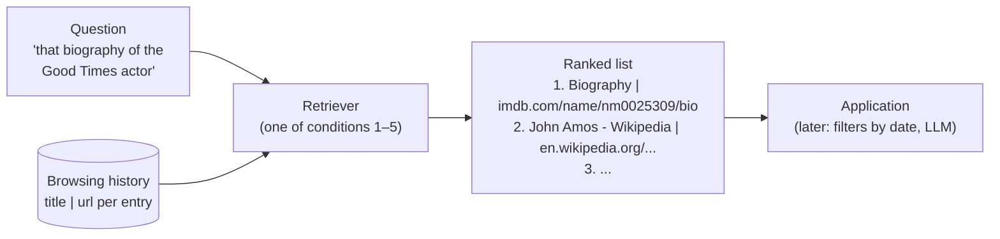
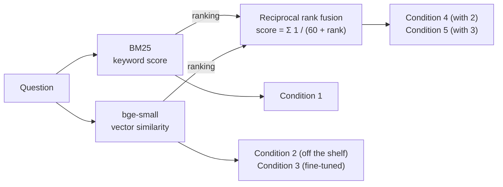
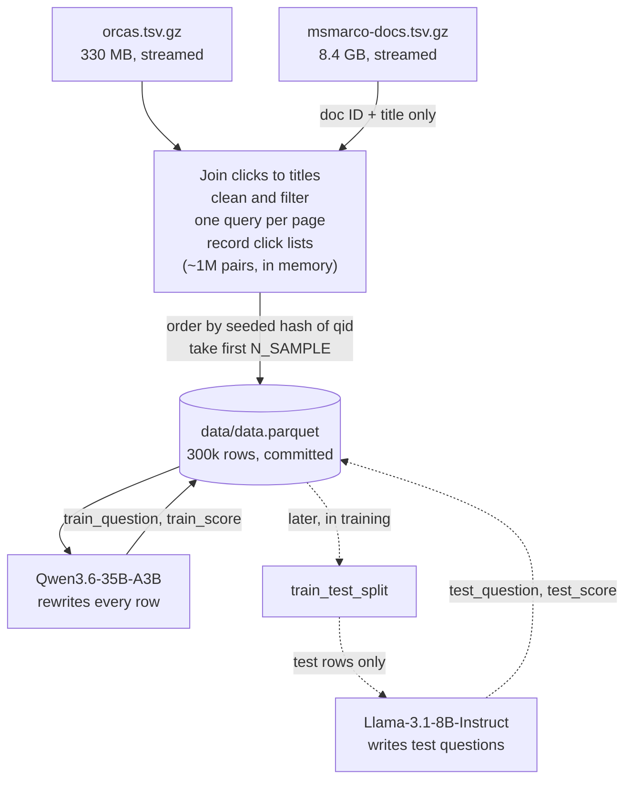
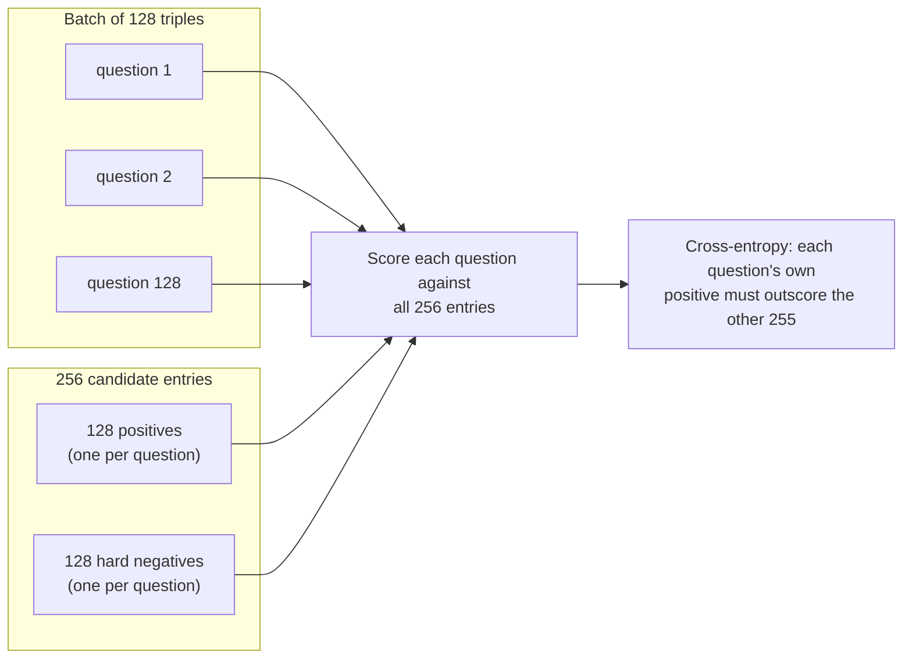
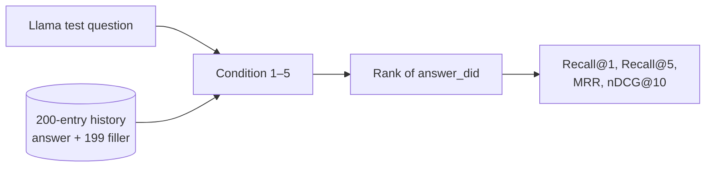

# Breadcrumbs History Retriever

A retriever for browsing history. A person asks a conversational question, such as "that biography of the Good Times actor I looked at," and the system ranks the pages in their history so the one they mean comes first.

Browser history search matches the literal words typed against page titles and URLs, but people asking an assistant describe a page in their own words and rarely remember its exact title. The goal is a retriever that returns the right page for whatever the person asks. To train one, the project turns real search clicks into conversational questions with an LLM, fine-tunes a small embedding model on them, and compares it with keyword, off-the-shelf dense, and hybrid retrieval on held-out questions.

The project runs locally in Jupyter notebooks in VS Code on an Apple Silicon Mac. It is non-commercial coursework.

> **Status:** final evaluation in progress. The data step (`data.ipynb`) and the exploratory runs in `models.ipynb` are done. The final experiment compares eight conditions on test questions regenerated with a neutral prompt; see [`PLAN.md`](PLAN.md). Part 2 then moves the final model into the Breadcrumbs History Assistant app. The test set is scored once, at the end.

## Research question

**When people ask an assistant about their browsing history in their own words, what is the best way to build and fine-tune a retriever so it returns the page they mean?**

The questions are the fixed part of the problem: they are whatever a person would ask, however they phrase it. The test set stands in for those questions, and the retriever is judged on how often it puts the right page first. Rewriting search queries into questions is only how the project produces training data; it is a means, not the subject of the study. The study compares keyword search, an off-the-shelf embedding model, the same model fine-tuned, and hybrids of these, to find which approach serves those questions best.

## How it works

A history entry is the title and URL a browser saves for each visit. Browsers do not store page text, so the system never uses page bodies. The model reads each entry as one string:

```text
Biography | imdb.com/name/nm0025309/bio
```

The retriever scores every entry in the history against the question and returns them in ranked order. Entry vectors are computed once, so a search costs one question encoding plus one dot product per entry, which takes milliseconds on a laptop CPU.



### Conditions compared

| # | Condition | Role |
| --- | --- | --- |
| 1 | BM25 (k1 = 1.2, b = 0.75) | **Baseline.** Strong keyword search, a stronger version of the literal matching in Chrome's standard history search |
| 2 | all-MiniLM-L6-v2, off the shelf | The embedder the Breadcrumbs app uses today |
| 3 | bge bi-encoder, off the shelf | Dense retrieval without training |
| 4 | bge bi-encoder, fine-tuned on the rewritten questions | **The method under test** (3 seeds) |
| 5 | Hybrid of 1 and 4 | Reciprocal rank fusion |
| 6 | 4 + bge reranker, off the shelf, on the top 10 | Reads question and entry together, without training |
| 7 | 4 + bge reranker, fine-tuned, on the top 10 | **Final model** (3 seeds); added after the error analysis |
| 8 | Claude ranking the whole history | Hosted reference on 500 test questions; never part of the app |

The bi-encoder and reranker sizes (bge-base or bge-large; bge-reranker-base or bge-reranker-v2-m3) are chosen once on validation: the best Recall@1, with reranking under about 250 ms per question. Earlier exploratory conditions used bge-small; the RRF hybrid with the off-the-shelf model is dropped.



Reciprocal rank fusion merges the two rankings using ranks alone, so BM25 and dense scores never need to be put on the same scale.

| Comparison | Question it answers |
| --- | --- |
| 2, 3 vs 1 | Does dense retrieval beat keyword search? |
| **4 vs 3** | **Does fine-tuning on the rewritten questions help?** The model is identical and only the training differs. |
| 5 vs 4 | After fine-tuning, does adding BM25 still help? |
| 6, 7 vs 4 | Does a reranker help, and does it need fine-tuning? |
| 7 vs 2 | How much better is the final model than the app's current embedder? |
| 7 vs 8 | How close is a small local model to a large hosted LLM? |

### Reranker (condition 6)

The error analysis showed the answer is in the fine-tuned model's top 20 for about 97% of questions but often not first. Many misses need the question and the page read together (a "city in Quebec" is Trois-Rivières, not the province page). A cross-encoder does that, but it costs one model pass per page. So it only reorders a fixed small top k from the bi-encoder, never the whole history, which keeps the cost flat as a real history grows to thousands of pages.

- **Training data mirrors evaluation.** Each of the 50k training rows gets a pseudo-history built like the real ones: the answer, 100 BM25 look-alikes and 99 random training pages. The fine-tuned bi-encoder ranks it, and its 7 top non-answer pages become hard negatives.
- **Loss.** `MultipleNegativesRankingLoss` for cross-encoders: a softmax over the positive, its 7 hard negatives and 4 in-batch negatives. Training uses 1 epoch, bf16, `max_length` 128.
- **Tested:** `cross-encoder/ms-marco-MiniLM-L-6-v2` (22M) and `ms-marco-MiniLM-L-12-v2` (33M), at k = 10, 20, 50 and 200.

### Out of scope

- **An LLM at question time.** A second LLM step (for example an 8B model reranking the top 5) would add about a second per question. The design keeps question time to small encoders; LLMs only write training data or help with analysis offline.
- **LLM generation and result filtering.** Filtering the ranked list, for example by visit date, belongs to the application and comes later. Real histories record visit times, but ORCAS does not, so this data cannot evaluate date handling.

## Data

### Sources

| File | Contents | Size | Use |
| --- | --- | --- | --- |
| `orcas.tsv.gz` | `qid, query, did, url` for about 18.8 million Bing searches and the page clicked for each | 330 MB | Searches, clicked pages, URLs |
| `msmarco-docs.tsv.gz` | `did, url, title, body` for about 3.2 million web pages | 8.4 GB | Page titles only |

Both come from [MS MARCO](https://microsoft.github.io/msmarco/) and are licensed for non-commercial research use only. Work that uses ORCAS cites Craswell et al. (2020).

### Data flow



Only `data/data.parquet` is saved. Both source files are read straight from their URLs and decompressed in memory; nothing else is written to disk.

1. **Stream ORCAS**, about one minute.
2. **Stream MS MARCO titles.** The 8.4 GB file is decompressed as it downloads, keeping only the document ID and title, and only for pages clicked in ORCAS. This takes about 15–20 minutes.
3. **Join each click to its page title, then clean:**
   - Drop queries and titles with no letters or digits.
   - Drop titles over 20 words, which are usually scraped page text rather than real titles.
   - Drop queries with non-ASCII characters, which are mostly non-English.
   - Keep one clicked page per query as its answer, then one query per page, so no page answers two different questions.
   - Normalize URLs: remove the scheme, a leading `www.`, and trailing slashes.
4. **Record click lists.** For every query, `clicked_dids` lists every page the searcher clicked, including the answer. The cleaned result is about 1 million pairs, held in memory.
5. **Sample.** Order the pairs by a seeded hash of each `qid` and take the first `N_SAMPLE` rows (default 300,000), then write `data/data.parquet`. A row's position depends only on its own `qid`, so a larger sample always contains a smaller one, and a change to the cleaning filters never reshuffles the rows that remain.
6. **Rewrite with Qwen.** Qwen3.6-35B-A3B rewrites every sampled search into a conversational question, filling `train_question` and `train_score`. The run saves progress into `data/data.parquet` every few thousand rows and skips rows already done, so an interrupted run resumes where it stopped. Rows are processed in sample order, so a run stopped early still leaves a clean random subset.
7. **Check and save** against the guarantees listed under the schema.

Test questions are written later, in the training notebook. After `train_test_split`, Llama-3.1-8B-Instruct writes a question for each validation and test row only, and the result is saved back into `data/data.parquet` by `qid`. Rerunning the same split reuses them.

**Neutral prompt for validation and test questions.** The first version of the Llama prompt shared two rules with the Qwen prompt: never copy three or more consecutive title words, and describe the page loosely. Those rules make questions avoid the page's own words, which handicaps BM25 by design. For the final evaluation, the validation and test questions are regenerated without those two rules. The Qwen training questions keep them.

### Example row

```text
qid             4905047
query           john amos
answer_did      D2377650
title           Biography
url             imdb.com/name/nm0025309/bio
clicked_dids    [D2377650, D512904]
train_question  that biography of the Good Times actor I looked at        (Qwen)
train_score     -0.082
test_question   (empty unless this row lands in the test split)          (Llama)
```

The correct answer is the page the searcher clicked. A rewritten question keeps its row, so it keeps the same `answer_did`. Models never see `answer_did`; it is used only to build training pairs and to score rankings.

### Schema of `data/data.parquet`

One row per sampled query.

| Column | Type | Filled by | Meaning |
| --- | --- | --- | --- |
| `qid` | string | Sampling | ORCAS query ID |
| `query` | string | Sampling | Original keyword search |
| `answer_did` | string | Sampling | **The correct answer**: MS MARCO ID of the clicked page |
| `title` | string | Sampling | Answer page's title |
| `url` | string | Sampling | Answer page's normalized URL |
| `clicked_dids` | list of strings | Sampling | Every page clicked for this search, including `answer_did` |
| `train_question` | string | Qwen run | Conversational rewrite, used when the row is in training |
| `train_score` | float | Qwen run | Average token log-probability, used to filter training rows |
| `test_question` | string, empty outside test rows | Training notebook | Llama question, used when the row is in test |
| `test_score` | float, empty outside test rows | Training notebook | Llama's average token log-probability; a diagnostic, never a filter |

Guarantees checked before every save:

- `qid` and `answer_did` are each unique.
- `answer_did` is always in `clicked_dids`.
- `title` and `url` are never blank.

The entry string `title | url` is built in code and not stored. The URL often carries what the title lacks: in an earlier 152,500-row sample, 30% of titles were two words or fewer and 10% were identical to another page's title. "Biography" appeared 253 times, on IMDb pages whose actor is identified only in the URL.

### Why two LLMs

If one model wrote both training and test questions, the fine-tuned retriever could score well by learning that model's phrasing instead of the task. Qwen's rewrites have recognizable habits; in an earlier run, "show me the" began 15% of them. Test questions therefore come from a different model family, following BEIR (Thakur et al., 2021). Each row is either training or test, never both, so no question, page, or phrasing appears on both sides.

### What reruns when something changes

| Change | What reruns |
| --- | --- |
| Split, test size, seed, training filters, hyperparameters | Nothing in the data step |
| Entry formatting (`title \| url` or title only) | Nothing; built in code |
| Smaller `N_SAMPLE` | Nothing; the first N rows are already rewritten |
| Larger `N_SAMPLE`, or any cleaning filter | Stream both sources again (~30 min); existing rewrites are reattached by `qid`, and only new rows are rewritten |
| Rewrite prompt or model | The full Qwen run |
| Crash, kernel restart, laptop sleep | Nothing after `data.parquet` is written; the Qwen run resumes where it stopped |

The rewrite prompt is settled on a 500-row pilot before the full run, since changing it later is the one expensive rerun.

### Size

GitHub rejects files over 100 MB. If `data.parquet` approaches that limit, it is written with stronger compression or as a few row-chunk files that load as one table.

## Training

The method under test fine-tunes bge-small-en-v1.5 (33M parameters, 384-dimension vectors) so a question's vector lands near its answer entry's vector. The recipe is contrastive training with in-batch negatives plus one hard negative per question, following DPR (Karpukhin et al., 2020).

### Preparing training rows

Done in the training notebook, not the data step:

1. **Split** with `train_test_split`, passing counts rather than fractions: 2,000 test and 500 validation rows. 2,000 test questions measure Recall@5 to about ±1 point.
2. **Write test questions** with Llama for the test and validation rows.
3. **Drop training rows** whose `answer_did` appears in any test or validation row's `clicked_dids`.
4. **Filter training rows:**
   - drop title copies (four or more consecutive title words);
   - drop rewrites containing CJK characters;
   - drop duplicate questions;
   - drop the lowest 10% by `train_score` (`drop10`, chosen on validation);
   - cap how often a three-word opening may start a question.
5. **Mix in about 30% original keyword queries** so the model still handles short searches.
6. **Mine one hard negative per question.** The current recipe (`NEGATIVES = "lookalike"`) uses the top BM25 match of the *answer page's own entry* over training entries, skipping the row's `clicked_dids`, the same way the evaluation histories are built. The original recipe, the top BM25 match of the question, scored 1.8 points lower.

### One training example

```text
question  that biography of the Good Times actor I looked at
positive  Biography | imdb.com/name/nm0025309/bio                  ← answer_did
negative  John Amos - Wikipedia | en.wikipedia.org/wiki/John_Amos  ← BM25 hard negative
```

The hard negative looks right but is wrong. Random pages from the batch are easy to reject on topic alone, while test histories contain same-topic and near-duplicate pages, so the model needs examples that force fine distinctions. Excluding every page in `clicked_dids` keeps pages the searcher actually opened from being taught as wrong. If hard negatives hurt on validation, training falls back to in-batch negatives only.

### One batch



Every other question's positive and negative act as extra wrong answers (in-batch negatives). This is safe because no page is the answer to two questions.

| Setting | Value |
| --- | --- |
| Base model | `BAAI/bge-small-en-v1.5` |
| Loss | `MultipleNegativesRankingLoss` (sentence-transformers) |
| Batch size | 128 |
| Learning rate | 2e-5, 10% warmup |
| Epochs | 1 |
| Max length | 64 tokens |
| Query prefix | `Represent this sentence for searching relevant passages: ` |
| Seeds | 3 (final runs); experiments use seed 0 |
| Device | Mac GPU (MPS); full precision for final runs, bf16 for experiments |

**Experiments.** The `models.ipynb` SETTINGS cell switches the notebook into experiment mode (`RUN_FINAL = False`). Each experiment trains one seed-0 model on 50k question rows in bf16 and writes `results/experiments/<name>/validation.json`.

**Learning curve.** If time allows, the model is also trained on the first 25k and 100k training rows to show whether more data still helps.

## Evaluation

Each validation or test question ranks its own 200-entry history. The history holds the answer, 100 BM25 look-alikes of the answer's own entry (same-topic and near-duplicate pages) and 99 random pages from the sample. No other page in the question's `clicked_dids` enters its history, so exactly one entry is correct. All conditions rank the same histories (`data/histories.parquet`).



| Metric | Meaning with one correct entry |
| --- | --- |
| Recall@1, Recall@5 | Is the answer ranked first, or in the top 5? |
| MRR | 1 ÷ the answer's rank, averaged over questions |
| nDCG@10 | 1 ÷ log₂(rank + 1) if the answer is in the top 10, else 0 |
| CPU ms per question | Search speed on a laptop CPU, with entry encoding timed separately |

Differences between conditions are tested with a paired bootstrap over test questions. All choices (score cutoff, checkpoint, hard negatives, reranker k) are made on validation. Test is run once per final model. With 500 validation questions, Recall@1 has a standard error of about 2 points, so validation differences under about 3 points are treated as noise.

**Guard against fitting the synthetic questions.** Validation is scored on three question sets for the same 500 pages:
- the Llama questions: the primary metric, written by a different LLM from the training questions;
- the Qwen questions: the same style as training;
- the original keyword queries, typed by real people.

A change counts only if its Llama gain is not paid for by a drop on the keyword queries. Anything tuned beyond a single choice (blend weights, thresholds) is tuned on held-out training rows, not on validation.

### Success

**Primary.** On the 2,000 Llama-written test questions, the fine-tuned model (condition 3) beats both BM25 (1) and the off-the-shelf model (2) on Recall@5:

- The paired-bootstrap 95% confidence interval for the gain excludes zero.
- The target gain is at least 10 points.
- The gain holds across all 3 seeds.

**First check on validation.** If a baseline already scores above about 85% Recall@5, a 10-point gain is impossible. In that case the histories are made harder or Recall@1 becomes the primary metric, decided on validation before any test run.

**Outcome of the check.** Off-the-shelf bge-small scored 0.896 validation Recall@5, so **Recall@1 is the primary metric**, with MRR breaking ties. The current target is validation Recall@1 ≥ 0.82.

**Secondary checks:**

| Check | Signal |
| --- | --- |
| Style gap | Score on Qwen-written questions minus score on Llama-written questions for the same test pages. A small gap means the model learned the task, not Qwen's style. |
| Keyword robustness | Score on the original ORCAS queries for the test pages does not drop after fine-tuning. |
| Learning curve | Recall@5 at 25k, 100k, and the full training set. |
| Speed | CPU ms per question stays close to the off-the-shelf model. |

**Error analysis.** 100 test errors are hand-labeled by type, such as same-topic confusion, near-duplicate page, vague question, or uninformative title.

A result that misses the target is still reported in full with its analysis.

## Models

| Role | Model | Where it runs |
| --- | --- | --- |
| Training rewrites | [Qwen3.6-35B-A3B](https://huggingface.co/Qwen/Qwen3.6-35B-A3B), 4-bit MLX ([mlx-community/Qwen3.6-35B-A3B-4bit](https://huggingface.co/mlx-community/Qwen3.6-35B-A3B-4bit)) | Data step, every sampled row |
| Test questions | [Llama-3.1-8B-Instruct](https://huggingface.co/meta-llama/Llama-3.1-8B-Instruct), 4-bit MLX ([mlx-community/Meta-Llama-3.1-8B-Instruct-4bit](https://huggingface.co/mlx-community/Meta-Llama-3.1-8B-Instruct-4bit)) | `models.ipynb`, test and validation rows only |
| Retriever | [bge-small-en-v1.5](https://huggingface.co/BAAI/bge-small-en-v1.5) | Conditions 2–5, and the model the application uses |
| Keyword search | BM25 via bm25s | Conditions 1, 4, 5, histories, and hard-negative mining |
| Reranker | [ms-marco-MiniLM-L-6-v2](https://huggingface.co/cross-encoder/ms-marco-MiniLM-L-6-v2), [ms-marco-MiniLM-L-12-v2](https://huggingface.co/cross-encoder/ms-marco-MiniLM-L-12-v2), fine-tuned | Condition 6, reordering the bi-encoder's top k |

Qwen and Llama only write questions; they are never evaluated. Both run with MLX on the Mac's GPU:

- **Greedy decoding**, so outputs and scores are reproducible.
- **Qwen thinking mode off.** Qwen3.6 reasons in a hidden block by default, which wastes time on a one-line rewrite and distorts the confidence score.
- **Rotating example sets.** The few-shot examples rotate among a small number of fixed sets, chosen per query by a seeded hash, which varies the phrasing while keeping output deterministic.
- **Cached prompt start.** The shared instructions are processed once per example set, not once per row.
- **Short outputs.** Generation stops at the first newline or after about 40 tokens.

The MLX build of Qwen3.6 is labeled as an image-and-text model, so it may need `mlx-vlm` rather than `mlx-lm`. This is checked first; the fallback is Qwen3-4B-Instruct-2507, a text-only model.

Llama is gated: accept its license on Hugging Face, then run `hf auth login` once.

### The `models/` folder

Everything model-related lives under `models/`, which git ignores apart from its `.gitkeep`.

```text
models/
  hf/                    Hugging Face cache: every downloaded model (Qwen, Llama, bge-small)
  checkpoints/           saved during training, so a stopped run resumes
    bge-ft-seed0/
  trained/               final models for evaluation and the application
    bge-ft-seed0/
    history-retriever/   the model selected on validation, used by the application
```

- **Downloads.** The notebooks set `HF_HOME` to `models/hf` before importing any Hugging Face library, so every download lands in the repo folder instead of `~/.cache`. Each model's revision is pinned.
- **Checkpoints during training.** The trainer saves a checkpoint every few hundred steps to `models/checkpoints/<run>/`, so an interrupted run resumes from the last one.
- **Final models.** Each trained model is saved as a standard sentence-transformers folder in `models/trained/<run>/`, with a `training_info.json` recording the base model, seed, training rows, settings, and validation metrics. The query prefix is stored in the model's config, so the application cannot forget it.

### Using the trained model in the application

Weights are saved as **safetensors**, not pickle. Loading a pickle runs arbitrary code and breaks when library versions change; a safetensors folder holds only the weights, tokenizer, and pooling settings, and loads with one call:

```python
from sentence_transformers import SentenceTransformer

model = SentenceTransformer("models/trained/history-retriever")
entries = model.encode(["Biography | imdb.com/name/nm0025309/bio", ...])  # once per history entry
question = model.encode("that biography of the Good Times actor", prompt_name="query")
scores = entries @ question  # higher is better; sort descending
```

Entries must be formatted exactly as in training: `title | url` with the URL normalized. A bge-small folder is about 130 MB, over GitHub's file limit, so trained models are shared through a private Hugging Face Hub repository or a GitHub Release rather than git. Exporting to another format for a non-Python application can be added later as a separate step that reads this folder.

## Compute estimates

Planning estimates for an M5 Pro with 64 GB of memory; measured timings, where they exist, are noted.

| Step | Estimate |
| --- | --- |
| Download ORCAS and stream MS MARCO titles | 20–30 min |
| Clean, join, sample | ~10 min |
| **Qwen rewrites, 300k rows** | **3–5 h, the main uncertainty**; set by the 500-row pilot |
| Llama test and validation questions, 2,500 rows | 10–15 min |
| Hard-negative mining | 10–15 min; batched BM25 on all CPU cores makes it a few minutes |
| Fine-tuning bge-small, 50k question rows, bf16 | measured ~17 min |
| Reranker negatives for 50k rows (pseudo-histories + bi-encoder ranking) | measured ~2 min |
| Cross-encoder training, 50k rows, bf16 | measured ~19 min (MiniLM-L6) and ~40 min (MiniLM-L12), with both running at once |
| Evaluating all conditions | ~15 min |

If the pilot projects the Qwen run past one night, training starts on whatever rows have finished, since the run fills rows in random order.

## Repo layout

```text
data.ipynb             download, clean, sample, Qwen rewrites
models.ipynb           SETTINGS; split, Llama questions, histories; BM25; bge-small off the shelf;
                       fine-tuning; cross-encoder reranker; validation and test scoring
data/
  data.parquet         the dataset
  splits.parquet       train / validation / test assignment by qid
  histories.parquet    the 200-entry history of every validation and test question
models/                downloads, checkpoints, trained models (gitignored)
results/
  scores.md, scores.csv     all scores so far
  error_analysis.md         where the models miss
  rankings/, speed/         per-question rankings and timings of the final conditions
  experiments/<name>/       validation.json (settings + metrics) of each experiment
```

The notebooks run on a `uv`-installed Python 3.11 with `requirements.txt`, in VS Code.

## Results so far

Exploratory runs. Validation, 500 Llama questions written with the first (paraphrase) prompt; the final evaluation re-scores everything on the neutral-prompt questions. Fine-tuned rows use 50k training rows, bf16 and seed 0. Full numbers are in `results/scores.md` and `results/experiments/`.

| Model | Recall@1 | Recall@5 | MRR |
| --- | --- | --- | --- |
| BM25 | 0.476 | 0.708 | 0.582 |
| bge-small, off the shelf | 0.654 | 0.896 | 0.764 |
| bge-small fine-tuned, question BM25 negatives (`baseline-50k`) | 0.690 | 0.902 | 0.783 |
| bge-small fine-tuned, look-alike negatives | 0.708 | 0.920 | 0.798 |
| + MiniLM-L6 cross-encoder, top 10 | 0.722 | 0.926 | 0.810 |
| + MiniLM-L12 cross-encoder, top 10 | **0.738** | **0.932** | **0.824** |

The same pages with the other two validation question sets (Recall@1):

| Model | Llama | Qwen (training style) | Keyword (real searches) |
| --- | --- | --- | --- |
| bge-small, off the shelf | 0.654 | 0.622 | 0.552 |
| bge-small fine-tuned, look-alike negatives | 0.708 | 0.708 | 0.626 |
| + MiniLM-L6, top 10 | 0.722 | 0.698 | 0.624 |
| + MiniLM-L12, top 10 | 0.738 | 0.716 | 0.598 |

What has been learned:

- **Negatives that look like the evaluation's look-alike pages help most.** No other training change has helped: a higher learning rate, more epochs, a bigger batch, and URLs split into words were each neutral or worse.
- **A reranker needs fine-tuning on this task.** Off the shelf, both MiniLM rerankers scored below the bi-encoder alone at k = 20 (0.670 and 0.656). Fine-tuned, they gain 1.4 to 3 points.
- **The reranker's gain does not pass the keyword check yet.** MiniLM-L12 gains 3 points on the Llama questions, but loses 2.8 points on the keyword queries and gains less than a point on the Qwen questions. The likely cause: the reranker trained on Qwen questions only, while the bi-encoder also trains on about 30% keyword queries. The fine-tuned bi-encoder itself shows no style gap (Qwen = Llama = 0.708).
- **A small k is enough.** Raising k past 10 does not help, and k = 10 costs about 7 ms (L6) to 12 ms (L12) per question on the Mac GPU.
- **Gains are small next to the noise.** On 500 questions, differences under about 3 points are noise.
- **The ceiling may be near 0.85.** The error analysis estimates that about 10 in 25 misses cannot be told apart from the question and `title | url` alone.

## Next

The final experiment and the move into the app are planned in [`PLAN.md`](PLAN.md):

1. **Part 1, this repo:**
   - regenerate the validation and test questions with the neutral prompt;
   - choose the model sizes on validation;
   - train the fine-tuned conditions with 3 seeds;
   - score conditions 1–8 once on test (Llama, Qwen and keyword questions, with a paired bootstrap and latency);
   - write the report.
2. **Part 2, the Breadcrumbs History Assistant app, local branch `model`:** a retrieval-augmented generation (RAG) design.
   - One trained retriever makes the language decisions. Its reranker reads each candidate's visit time written as text, such as "1 day ago", so it can answer date questions.
   - The local LLM only writes the reply.
   - Training uses the user's own history.

## Later: browsing behaviour from real Chrome histories

About 10 of the 25 sampled misses cannot be told apart from the question and `title | url` alone. Real histories record when and how often a page was visited, which can settle such cases, but ORCAS has no visit times, so this step needs real Chrome histories and is left for later.

- **Design.** Keep the text model trained here unchanged. Add a small combiner on top: text score plus a few behavioural features (days since last visit, visit count, typed count, whether it was reached from a search, same session). It has about 5–10 weights, so a few hundred labelled examples are enough.
- **Labels without a training set.** Chrome's `History` database records revisits. Each time a person goes back to an older page (`keyword_search_terms` links their search to the resulting URL; `visits` stores the transition type), the pages visited before that moment form the history, the revisited page is the answer, and the search, rewritten into a question by the local LLM, is the question. Keep revisits that look like re-finding (reached through a search, more than a day since the last visit, rarely visited pages) and drop navigation habits such as typed URLs of daily sites.
- **Evaluation.** Fit on earlier months and test on later ones, never a random split, so visit counts never include future visits.
- **Human questions.** Every question in this project is LLM-written or a search query. The final check is questions the user writes in their own words about their own history; the model chosen here is confirmed on them before any further tuning.
- **Do not** add synthetic timestamps to ORCAS to learn these weights; they would only learn the made-up assumptions.

Privacy:

- Browsing history reveals health, finances, politics and location, and URLs alone identify people.
- Everything stays on the machine: the LLM rewrite runs locally, never through a cloud API.
- Raw histories, rankings and notebook outputs that show titles or URLs stay in gitignored folders on an encrypted disk; only aggregate metrics are committed.
- Other people's histories need informed consent and ethics approval first, collect only the needed fields, and have a deletion date. Models trained on them are not shared.

Bias to report as limitations:

- **One person's history is a case study.** The weights describe that person's habits and do not generalise.
- **Revisit labels only contain pages that were found again,** so they under-represent the hard cases the assistant is for.
- **A visit-count prior feeds itself:** boosted pages get clicked and so visited more. Keep its weight small and on a log scale, so that a strong text match can always overrule it.
- **Search-based revisits inherit the search engine's ranking.**
- **The text model comes from English Bing searches** and LLM-written questions, so expect weaker results on non-English or niche pages. Report results per language and site type.
- **A private page may rank first for a vague question** while someone else is watching the screen. Let the user exclude sites.

## References

- ORCAS: Craswell et al., 2020. Query–click pairs.
- MS MARCO: Nguyen et al., 2016. Page titles.
- BM25: Robertson and Zaragoza, 2009. Keyword baseline.
- BGE: Xiao et al., 2023. The embedding model.
- DPR: Karpukhin et al., 2020. Contrastive training with in-batch and hard negatives.
- Sentence-BERT: Reimers and Gurevych, 2019. Training library.
- BEIR: Thakur et al., 2021. Motivates a separate test-question writer.
- Reciprocal rank fusion: Cormack et al., 2009. Hybrid ranking.
- InPars: Bonifacio et al., 2022; doc2query: Nogueira et al., 2019. Generating training queries with language models.
