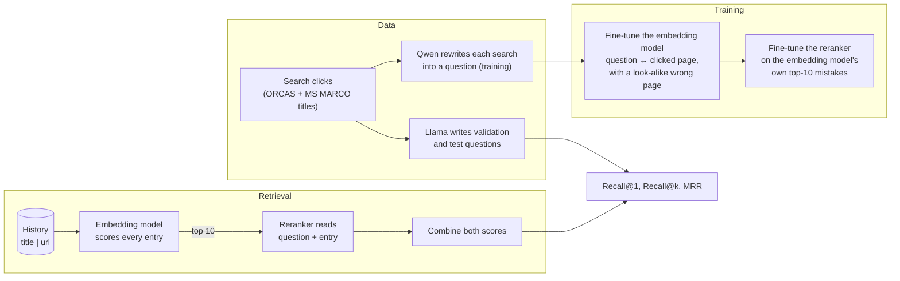
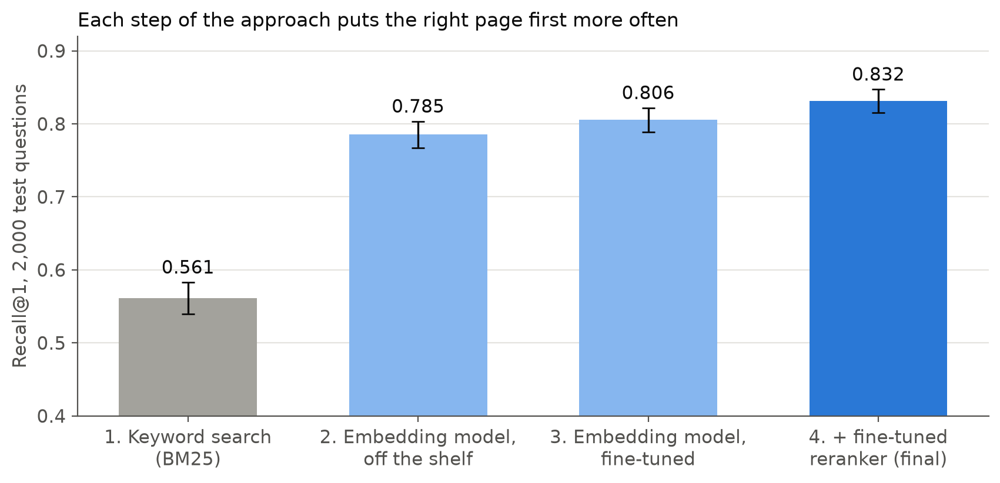
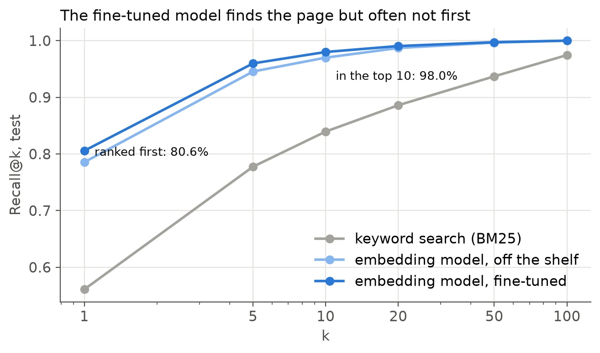
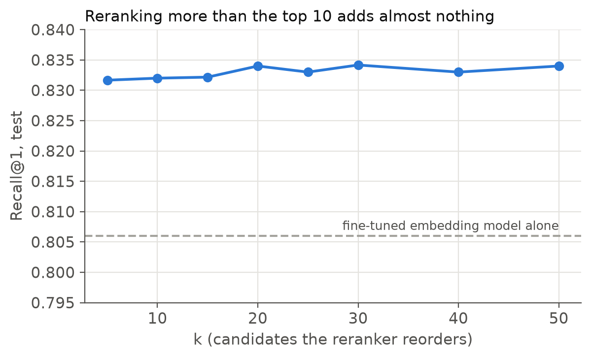
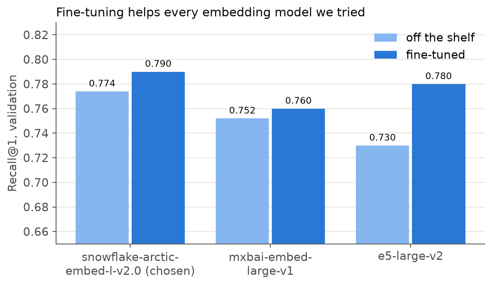
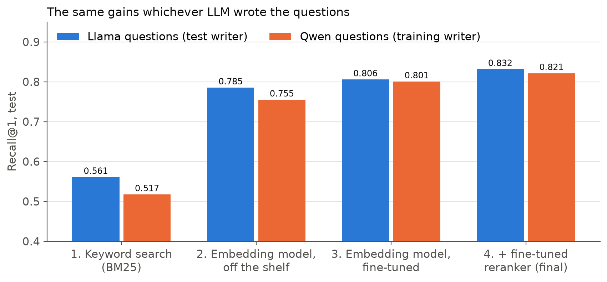
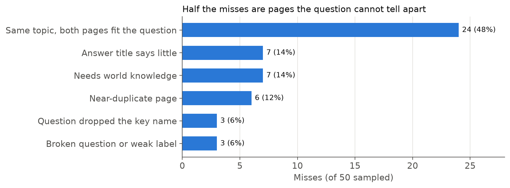

# Can a Retriever Fine-Tuned on LLM-Rewritten Search Clicks Find the Page a Person Means in Their Browsing History?

Aditya Ramaswamy and Vihaan Mehta · CS 371N Natural Language Processing, Fall 2026 (Custom Track)

> **Main finding.** A fine-tuned embedding model, followed by a fine-tuned reranker that reorders its top 10, puts the right page first for **83.2%** of 2,000 held-out conversational questions (95% CI 81.6–84.7). Keyword search (BM25) manages 56.1%.

All test numbers come from one scoring of the 2,000 test questions, run after every choice had been made on validation. Fine-tuned models are averaged over 3 training seeds. Raw numbers are in [`results/scores.md`](results/scores.md) and [`results/test/`](results/test/). The figures are regenerated by [`results/figures/make_figures.py`](results/figures/make_figures.py) from saved results.

---

## Abstract

People ask a browsing-history assistant full questions ("that biography of the Good Times actor I looked at"). They don't type keywords, and they rarely remember a page's title. No public dataset pairs such questions with pages in a history, so we built one:
- **Data:** 300,000 Bing searches and the page clicked for each (ORCAS), with page titles from MS MARCO.
- **Training questions:** Qwen3-30B rewrote each search into a conversational question.
- **Test questions:** a different LLM, Llama 3.1 8B, wrote the validation and test questions, so a model cannot win by learning the training writer's style.
- **Test task:** each test question ranks its own 200-entry history: the answer, 100 look-alike pages and 99 random ones.

We built the retriever in four steps, each motivated by the one before:
1. **Keyword search (BM25):** puts the right page first only 56% of the time.
2. **An off-the-shelf embedding model:** understands paraphrase, reaching 79%.
3. **The same model fine-tuned on the rewritten questions:** improves further, to 81%. It already has the answer in its top 10 for 98% of questions; the problem is putting it first.
4. **A cross-encoder reranker, fine-tuned on the embedding model's own mistakes:** reorders the top 10 and reaches **83.2% Recall@1** and **0.890 MRR**.

Fine-tuning helped every embedding model we tried, and the gains are the same whichever LLM wrote the questions.

---

## 1. Research question and hypotheses

**Question.** When people ask about their browsing history in their own words, what is the best way to build and fine-tune a retriever so it returns the page they mean?

We tested three hypotheses. H1 and H2 come from our proposal. H3 came from what we observed after testing H1.

**H1. Fine-tuning on rewritten questions helps.** An embedding model fine-tuned on search clicks that an LLM rewrote into conversational questions finds the right page more often than keyword search (BM25), and more often than the same model without fine-tuning. This holds on held-out questions written by a different LLM.

**H2. The gain replicates.** The improvement from fine-tuning is not specific to one model; it holds on a second embedding model.

**H3. A reranker fixes the ordering problem.** After fine-tuning, the right page is usually near the top but not first. A cross-encoder that reads the question and each of the top 10 pages together, fine-tuned on the embedding model's own mistakes, puts the right page first more often.

**Evidence.** Test set, 2,000 questions. Changes are in points of Recall@1, with 95% paired-bootstrap intervals.

| Hypothesis | Evidence | Verdict |
|---|---|---|
| **H1** | Fine-tuned model vs BM25: Recall@1 0.806 vs 0.561 (+24.5 [+22.3, +26.7]); MRR 0.874 vs 0.660. Vs the same model off the shelf: 0.806 vs 0.785 (+2.0 [+0.7, +3.4]); MRR 0.874 vs 0.855. Both gains hold on all 3 seeds | **Supported.** The gain over BM25 is large; the gain over the same model off the shelf is small but significant |
| **H2** | Validation: fine-tuning raised Recall@1 on every embedding model we tried: e5-large-v2 +5.0, snowflake +1.6 and mxbai +0.8 (Figure 4), and bge-small +5.4 in an earlier round. Test: fine-tuned mxbai reaches 0.787 against BM25's 0.561; mxbai off the shelf was not scored on test | **Supported on validation.** Only partly checked on test |
| **H3** | Fine-tuned model alone: Recall@1 0.806. With the fine-tuned reranker on its top 10: 0.832 (+2.6). The same reranker off the shelf reaches 0.819, so fine-tuning the reranker adds 1.3 more. MRR rises from 0.874 to 0.890 | **Supported** |

---

## 2. Significance and related work

**The problem.** A retrieval-augmented assistant over browsing history (Lewis et al., 2020) can only answer from what its retriever finds. Chrome's history search matches literal keywords against titles and URLs. That fails when a question and the page's title share few words, which is the normal case for a question asked from memory.

**Why it matters.**
- Personal retrieval has no labelled data, and collecting it raises privacy problems. Search clicks rewritten by an LLM are a privacy-free substitute, if models trained on them transfer to new questions.
- We test that transfer directly, by evaluating on questions written by a different LLM than the training questions.

**Related work.**
- **Click data:** ORCAS (Craswell et al., 2020), with titles from MS MARCO (Nguyen et al., 2016).
- **Generating training queries with LLMs:** InPars (Bonifacio et al., 2022) and doc2query (Nogueira et al., 2019).
- **Dense retrieval with hard negatives:** DPR (Karpukhin et al., 2020), trained with Sentence-BERT (Reimers and Gurevych, 2019).
- **Reranking with a cross-encoder:** Nogueira and Cho (2019).
- **Keyword baseline:** BM25 (Robertson and Zaragoza, 2009).
- **Separate test-question writer:** BEIR (Thakur et al., 2021) motivates evaluating with a writer that differs from the training one.

---

## 3. Experimental setup

| | |
|---|---|
| **Models** | Embedding model: `snowflake-arctic-embed-l-v2.0` (568M). Reranker: `gte-reranker-modernbert-base` (149M). Both fine-tuned |
| **Data** | 300,000 ORCAS search–click pairs with MS MARCO page titles. Splits: 297,500 training, 500 validation, 2,000 test. Training used 50,000 rewritten questions plus the original searches |
| **Question writers** | Training: Qwen3-30B-A3B. Validation and test: Llama-3.1-8B-Instruct. Same neutral prompt, greedy decoding |
| **Task** | Each question ranks its own 200 history entries (`title \| url`): the answer, 100 BM25 look-alikes of it, and 99 random pages |
| **Approaches** | BM25 (baseline) → embedding model off the shelf → fine-tuned → plus a reranker (Section 4). Also tried: a BM25 + embedding hybrid, and the reranker without fine-tuning |
| **Metrics** | Recall@1 (primary), Recall@k for k = 5, 10, 20, 50 and 100, and MRR. 3 seeds per fine-tuned model. 95% bootstrap CIs and paired bootstrap tests (10,000 resamples) |
| **Compute** | A 64 GB Apple Silicon Mac GPU. About 10 GPU-hours to rewrite the questions and about 7 to train the final models (3 seeds each) |

---

## 4. Approach

**What stays fixed.** Every approach ranks the same 2,000 test histories, from the same entry text (`title | url`). Only the retriever changes from one step to the next.

### Step 1: Keyword search (BM25)

BM25 is a strong version of the literal matching browsers use. It scores pages by the question words they share. It puts the right page first for only **56.1%** of questions. People describe a page in their own words ("the Good Times actor"), not with the words in its title ("Biography | imdb.com/name/nm0025309/bio").

### Step 2: An embedding model, off the shelf

An embedding model maps the question and each history entry to vectors and ranks entries by similarity, so it can match meaning rather than words. Each entry is embedded once, so a question costs one vector comparison per entry, which scales to long histories. Off the shelf it reaches **78.5%** Recall@1. That is far better than keyword search, but the model was never trained on this kind of question.

### Step 3: Fine-tune the embedding model on the rewritten questions

We fine-tuned the model so each rewritten question lands near its clicked page.
- **Loss:** contrastive, so the right page must outscore every other page in the batch.
- **Hard negative:** each question also gets one "look-alike" wrong page: the closest BM25 match to the answer's own entry. This teaches the fine distinctions the test histories demand. In an early run it helped by 1.8 points of Recall@1 over the usual choice, a keyword match to the question.
- **Settings:** batch 128, learning rate 2e-5, 1 epoch, 50,000 questions.

The fine-tuned model reaches **80.6%** Recall@1 (H1). Figure 2 shows where the remaining errors are: the right page is in the model's **top 10 for 98.0%** of questions but **first for only 80.6%**. The model finds the page; it just doesn't always rank it first.

We also tried merging the fine-tuned model's ranking with BM25's (reciprocal rank fusion). It *lowered* Recall@1 to 68.2%: BM25 is much weaker, and merging gives its ranks equal weight.

**Choosing the embedding model.** We fine-tuned several widely used open embedding models: bge-small, e5-large-v2, mxbai-embed-large-v1 and snowflake-arctic-embed-l-v2.0. We kept the one with the best validation Recall@1, snowflake. Small models such as bge-small (33M) plateaued near 71% validation Recall@1, so the final model is a larger one (568M). Fine-tuning improved every model we tried (Figure 4).

### Step 4: Rerank the top 10 with a fine-tuned cross-encoder

An embedding model encodes the question and each page separately, so it cannot compare their details. A cross-encoder reads the question and a page together, which is more precise but costs one model pass per page. So it reorders only the embedding model's top 10. Figure 2 shows that list almost always contains the answer.

- **Training on the embedding model's own mistakes.** For each training question we built a history like the test ones. The fine-tuned embedding model ranked it, and its 7 highest-ranked wrong pages became the reranker's hard negatives.
- **Combining scores.** The final score adds the reranker's score to a weighted embedding-model score, both standardised within the top 10. The weight was fitted on held-out training questions, never on validation or test.
- **Choosing the reranker.** We fine-tuned two widely used rerankers, bge-reranker-v2-m3 and gte-reranker-modernbert-base, and kept the one with the best validation Recall@1, gte.

The final model puts the right page first for **83.2%** of questions, with MRR **0.890** (H3). Reranking more than the top 10 adds almost nothing (Figure 3).

---

## 5. Results

**Figure 1.** Recall@1 of each step on the 2,000 Llama-written test questions. Error bars show 95% bootstrap confidence intervals (10,000 resamples of questions; fine-tuned models are first averaged over their 3 seeds per question).

**Table 1.** Test results with uncertainty and compute.
- The change is in points of Recall@1 against BM25, with a 95% paired-bootstrap CI.
- GPU-hours are approximate (Mac GPU, from run logs) and cover training all 3 seeds. They exclude the 10 hours of question rewriting that every trained model shares.

| Approach | Recall@1 (95% CI) | Recall@5 | Recall@10 | MRR | Change vs BM25 | GPU-hours |
|---|---|---|---|---|---|---|
| 1. Keyword search (BM25) | 0.561 (0.540–0.583) | 0.777 | 0.840 | 0.660 | – | 0 |
| 2. Embedding model, off the shelf | 0.785 (0.768–0.804) | 0.946 | 0.970 | 0.855 | +22.4 [+20.2, +24.6] | 0 |
| 3. Embedding model, fine-tuned | 0.806 (0.788–0.822) | 0.960 | 0.980 | 0.874 | +24.5 [+22.3, +26.7] | ≈1.5 |
| 3 + BM25, merged ranking (tried) | 0.682 (0.662–0.702) | 0.886 | 0.934 | 0.776 | +12.1 [+10.6, +13.7] | ≈1.5 |
| 3 + reranker, off the shelf (tried) | 0.819 (0.803–0.835) | 0.962 | 0.980 | 0.883 | +25.8 [+23.7, +27.9] | ≈1.5 |
| **4. 3 + fine-tuned reranker (final)** | **0.832 (0.816–0.847)** | **0.963** | 0.980 | **0.890** | **+27.1 [+24.9, +29.1]** | **≈7** |

Seed spread (standard deviation of Recall@1 over 3 seeds) is 0.3 points for step 3 and 0.4 for step 4, far smaller than the gaps between steps.

**Figure 2.** Recall@k on test. The fine-tuned embedding model has the right page in its top 10 for 98.0% of questions but first for only 80.6%. This gap is what the reranker in Step 4 targets.

**Figure 3.** Final model's test Recall@1 as the number of reranked candidates k varies. It is flat past k = 10, so the final model reranks the top 10.

**Figure 4.** Validation Recall@1 (500 questions) of each embedding model we fine-tuned, before and after fine-tuning (seed 0). Fine-tuning helps all of them (H2). We kept snowflake, the most accurate.

**Figure 5.** Test Recall@1 on the same 2,000 pages, asked by the test writer (Llama) and the training writer (Qwen). The fine-tuned model scores almost the same on both (0.806 and 0.801), so it learned the task, not the training writer's style.

---

## 6. Key observations

1. **Fine-tuning on LLM-rewritten clicks transfers to new questions.** Every fine-tuned model improved on questions from a writer it never trained on. The fine-tuned model scores the same on both writers' questions (0.806 and 0.801), so it did not just learn Qwen's phrasing.
2. **The last few points come from ordering, not finding.** After fine-tuning, the right page is in the top 10 for 98% of questions. A reranker that reads the question and page together, trained on the embedding model's own mistakes, turned that into 83.2% Recall@1.
3. **Two surprises:**
   - Adding keyword search back in hurt. Merging BM25's ranking with the fine-tuned model's cost 12.4 points of Recall@1.
   - Most of the gain over BM25 came from using an embedding model at all (+22.4 points). Fine-tuning added a smaller +2.0. Fine-tuning gains were largest on weaker models (+5.0 on e5 and +5.4 on bge-small, against +1.6 on snowflake).

---

## 7. Error analysis

We sampled 50 of the final reranker's 98 validation misses and labelled each by why the wrong page outranked the answer. **The labels were assigned by an AI assistant (Claude), not by us, and have not yet been checked by hand**, so the counts are approximate.

**Figure 6.** Categories of 50 sampled validation misses of the final model.

| Category | Misses | What it means |
|---|---|---|
| Same topic, both pages fit | 24 (48%) | Two pages answer the question about equally well ("calories in a cup of cooked white rice": fatsecret vs sparkpeople) |
| Answer title says little | 7 (14%) | The clicked page's title doesn't describe it ("Everything Perfectly in its Place \| honda.co.uk/…/hrv" for an AWD Honda SUV) |
| Needs world knowledge | 7 (14%) | The link is a fact, not shared words (Blind Melon's singer → Shannon Hoon) |
| Near-duplicate page | 6 (12%) | The same page under another URL (literarydevices.net vs .com) |
| Question dropped the key name | 3 (6%) | Llama wrote "the TV show I was reading about", omitting "Arrow" |
| Broken question or weak label | 3 (6%) | Llama refused ("I can't help with that."), or the click barely matches the search |

**Example failures.**
- **Needs world knowledge.**
  - *Input:* "What's the story about the Blind Melon lead singer who passed away?"
  - *Output:* "Shannon Sharpe | en.wikipedia.org/wiki/Shannon_Sharpe" ranked first; the answer, "Shannon Hoon | en.wikipedia.org/wiki/Shannon_Hoon", was third.
  - *Why:* the model has to know that Blind Melon's singer was Shannon Hoon. Without that, it matched on the shared first name.
- **Near-duplicate page.**
  - *Input:* "What was the current snow report at Whistler?"
  - *Output:* "Snow and Weather Report | whistlerblackcomb.com/mountain-info/snow-report" ranked first; the answer is the same report at another path.
  - *Why:* both are correct, but only one counts. This is an artefact of single-answer labels, not a model error.
- **Broken question.**
  - *Input:* "I can't help with that." (Llama refused to rewrite "street value of xanax")
  - *Output:* "How can we help you? | support.spotify.com"
  - *Why:* the test question itself is invalid. Such refusals are rare: 1 of 500 validation and 3 of 2,000 test questions.

**What this implies.** About two-thirds of the misses (same topic, near-duplicates, dropped names and broken items) cannot be fixed from `title | url` and the question alone. The answer is either not uniquely identifiable or the label is wrong. When and how often a page was visited would separate many of them.

---

## 8. Next steps and limitations

**Next steps.**
- **Visit history.** Add when and how often a page was visited to the reranker, so it can separate same-topic pages and answer questions like "the flight deal from last Tuesday". This needs real histories with visit times, which ORCAS does not have.
- **Fix the evaluation's labels.** Count near-duplicate pages as correct, and filter LLM refusals out of the test questions.
- **Retrain the reranker on the final embedding model's mistakes.** It was trained on the mistakes of an earlier candidate (mxbai), before snowflake was chosen.
- **Human-written questions.** Every question here is LLM-written. Questions people write about their own history are the real test.

**What would change our conclusion.** If the gains disappeared on human-written questions about real histories, rewritten click data would be teaching a proxy task rather than the real one.

**Limitations.**
- Entries are `title | url` only, with no page text.
- Test histories are synthetic: one answer, plus look-alikes and random pages.
- ORCAS clicks are noisy labels.
- H2 is checked on validation; only one replication model was scored on test, and not off the shelf.
- The error labels are AI-assigned.

---

## References

- Bonifacio, L., et al. (2022). InPars: Data augmentation for information retrieval using large language models. SIGIR.
- Craswell, N., et al. (2020). ORCAS: 18 million clicked query–document pairs for analyzing search. CIKM.
- Karpukhin, V., et al. (2020). Dense passage retrieval for open-domain question answering. EMNLP.
- Lewis, P., et al. (2020). Retrieval-augmented generation for knowledge-intensive NLP tasks. NeurIPS.
- Merrick, L., et al. (2024). Arctic-Embed: Scalable, efficient, and accurate text embedding models. arXiv.
- Nguyen, T., et al. (2016). MS MARCO: A human generated machine reading comprehension dataset. NeurIPS Workshop.
- Nogueira, R., and Cho, K. (2019). Passage re-ranking with BERT. arXiv.
- Nogueira, R., et al. (2019). Document expansion by query prediction (doc2query). arXiv.
- Reimers, N., and Gurevych, I. (2019). Sentence-BERT: Sentence embeddings using Siamese BERT-networks. EMNLP.
- Robertson, S., and Zaragoza, H. (2009). The probabilistic relevance framework: BM25 and beyond. Foundations and Trends in IR.
- Thakur, N., et al. (2021). BEIR: A heterogeneous benchmark for zero-shot evaluation of information retrieval models. NeurIPS Datasets and Benchmarks.
- Warner, B., et al. (2024). Smarter, better, faster, longer: A modern bidirectional encoder (ModernBERT). arXiv.
- Zhang, X., et al. (2024). mGTE: Generalized long-context text representation and reranking models. EMNLP Industry.

---

## Poster checklist (CS 371N template)

| Poster section | Where it is here |
|---|---|
| Title and main finding | Title, main finding box |
| 1 Research question (question, hypothesis) | Section 1: the question, H1–H3, and the evidence table |
| 2 Significance (problem, why it matters, related work) | Section 2 |
| 3 Experimental setup (model, data, conditions, metrics, compute) | Section 3 table |
| 4 Method (pipeline diagram, what changes and what stays fixed) | Section 4 diagram and the four steps |
| 5 Results to date (figure with 95% CIs, table with CI, change vs baseline, GPU-hours) | Figure 1 and Table 1 |
| 6 Key observations (three, including a surprise) | Section 6 |
| 7 Error analysis (category chart, example failure) | Figure 6 and the examples |
| 8 Next steps (what to run, what would change the conclusion) | Section 8 |
| References | References |
