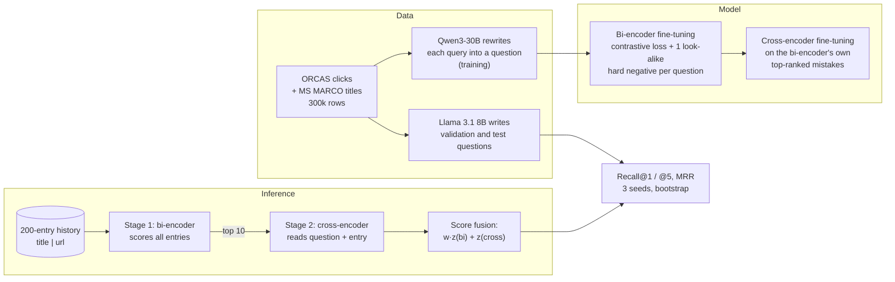
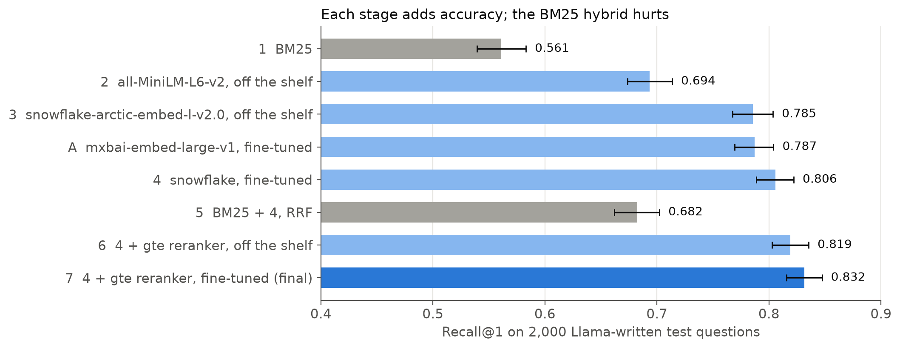
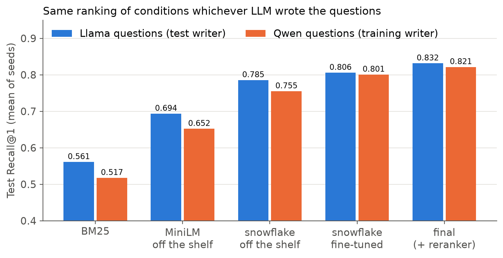
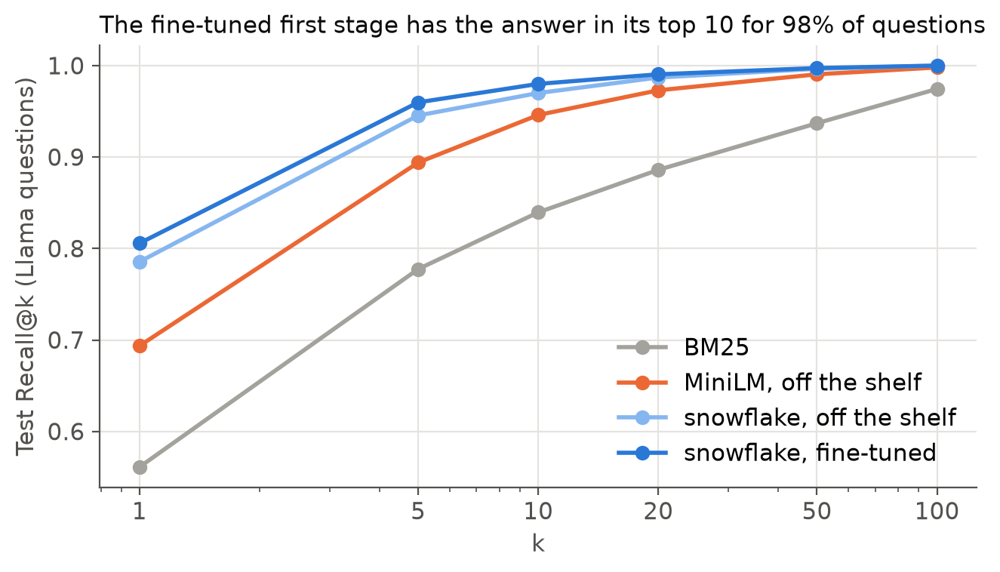
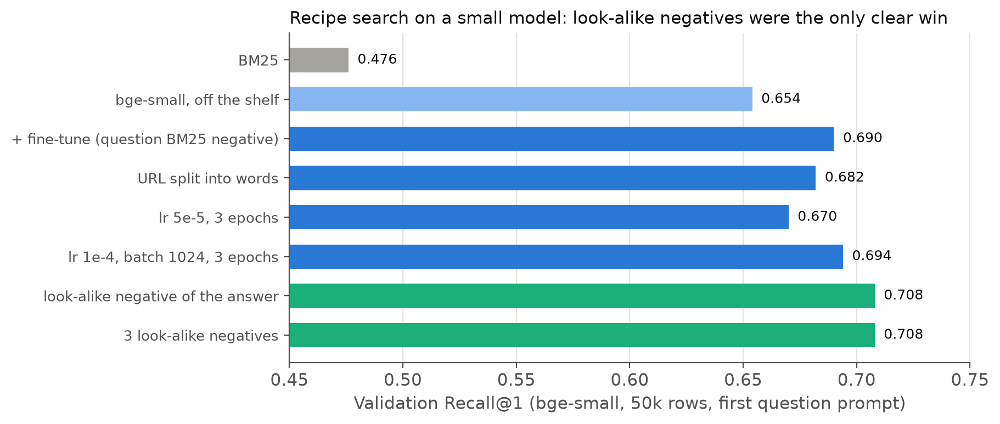
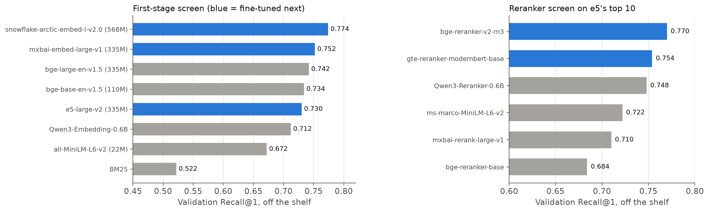
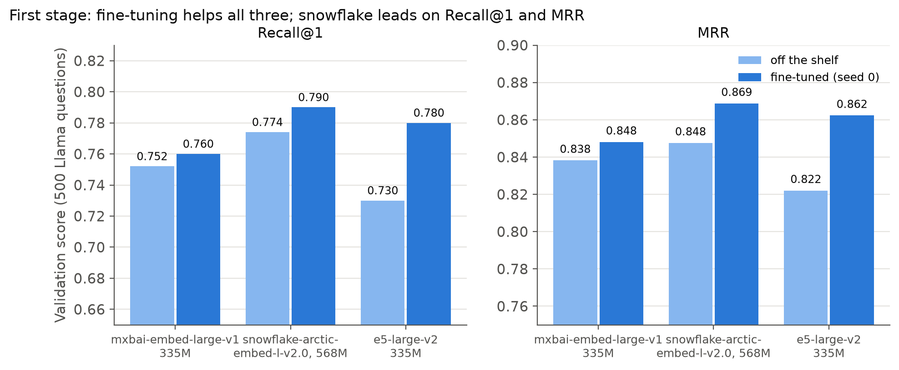
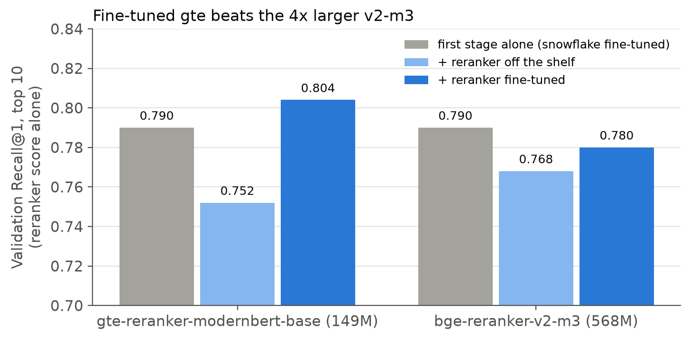
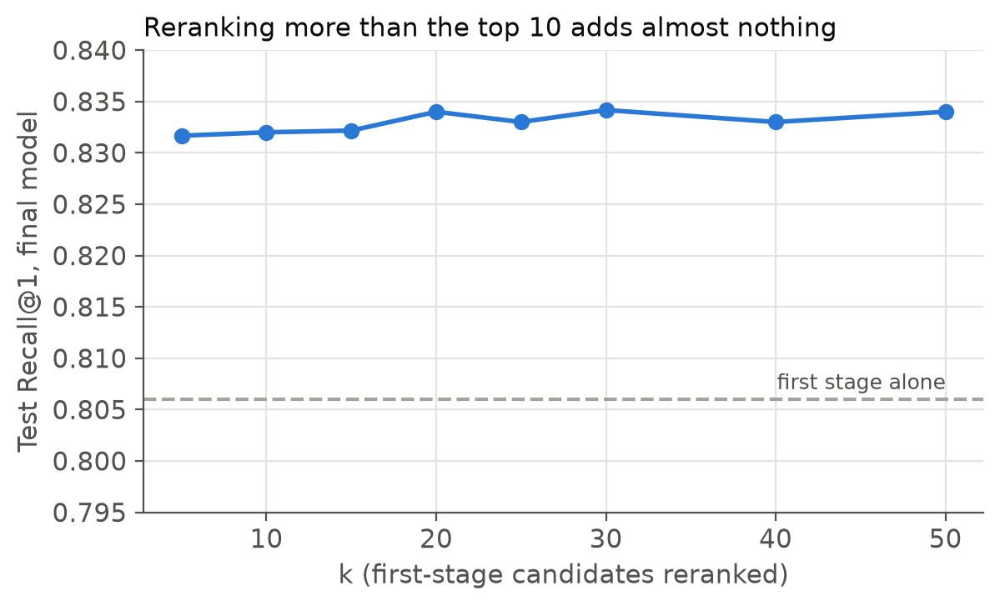

# Can Retrievers Fine-Tuned on LLM-Rewritten Search Clicks Find the Page a Person Means in Their Browsing History?

Aditya Ramaswamy and Vihaan Mehta · CS 371N Natural Language Processing, Fall 2026 (Custom Track)

> **Main finding.** A two-stage retriever, fine-tuned on search clicks that an LLM rewrote into conversational questions, puts the right page first for **83.2%** of 2,000 held-out questions (95% CI 81.6–84.7). That is +27.1 points over keyword search (BM25) and +13.8 over the widely used all-MiniLM-L6-v2 embedding model. Fine-tuning the same model adds a significant but small +2.0 points over its off-the-shelf version.

All test numbers come from one scoring of the 2,000 test questions, run after every model choice had been made on validation. Fine-tuned conditions average 3 training seeds. Raw numbers are in [`results/scores.md`](results/scores.md) and [`results/test/`](results/test/). Every figure is regenerated by [`results/figures/make_figures.py`](results/figures/make_figures.py) from saved results.

---

## Abstract

People ask a browsing-history assistant full questions ("that biography of the Good Times actor I looked at"). They don't type keywords, and they rarely remember a page's title. No public dataset pairs such questions with pages from a person's history, so we built one. We took 300,000 Bing query–click pairs (ORCAS) and their page titles (MS MARCO), and Qwen3-30B rewrote each keyword query into a conversational question. A different LLM, Llama 3.1 8B, wrote the validation and test questions, so a model cannot win by learning the training writer's style. Each test question ranks its own 200-entry history: the answer, 100 BM25 look-alikes of it and 99 random pages.

We compared keyword search, eight off-the-shelf embedding models, three fine-tuned embedding models and five rerankers. The final system has two stages:
- **First stage:** a fine-tuned `snowflake-arctic-embed-l-v2.0` bi-encoder (568M parameters).
- **Reranker:** a fine-tuned `gte-reranker-modernbert-base` cross-encoder (149M) that reorders the bi-encoder's top 10. Its score is combined with the bi-encoder's.

The system reaches Recall@1 0.832, Recall@5 0.963 and MRR 0.890, and the ranking of conditions is the same whichever LLM wrote the questions. We first fine-tuned a small model (bge-small, 33M), aiming for a 10-point Recall@5 gain. Off-the-shelf models already scored 90–95% Recall@5, so a gain that large was impossible. We switched to Recall@1 and larger models before running any test, and report the original hypothesis's outcome below.

---

## 1. Research question and hypothesis

**Question.** When people ask about their browsing history in their own words, which retriever, and which way of fine-tuning it, returns the page they mean?

**Original hypothesis.** Fine-tuning a small embedding model (bge-small, 33M parameters) on LLM-rewritten click data would raise Recall@5 by at least 10 points over BM25 and over the same model off the shelf, and the gain would replicate on a second model.

**Revised hypothesis, fixed on validation before any test run.**
- Off-the-shelf bge-small already reached 0.896 validation Recall@5, so a 10-point Recall@5 gain was impossible. Recall@1 became the primary metric, with MRR breaking ties.
- The small models' recipe experiments (Section 5.2) gained at most 5.4 points of Recall@1 and plateaued near 0.71. Their misses were capacity errors, which motivated the move to larger models and a reranker.
- The revised expectation: a fine-tuned large bi-encoder plus a fine-tuned cross-encoder reranker beats BM25, all-MiniLM-L6-v2 and the same bi-encoder off the shelf on Recall@1 and MRR.

**Outcome against each hypothesis.**

| Claim | Result on test | Verdict |
|---|---|---|
| Recall@5 rises ≥10 points over BM25 | +18.3 (fine-tuned snowflake), +18.6 (final) | Met |
| Recall@5 rises ≥10 points over the same model off the shelf | +1.4 (0.946 → 0.960); the baseline leaves only 5.4 points of headroom | Not met (ceiling) |
| Recall@1 improves over the same model off the shelf | +2.0 [95% CI +0.7, +3.4] (first stage), +4.6 [+3.3, +6.0] (final) | Met |
| Gain replicates on a second model | Fine-tuning raised validation Recall@1 on all four models tried. On test, fine-tuned mxbai (0.787) beats BM25 and MiniLM, but its off-the-shelf version was not scored on test | Partly met |
| A small (33M) model is enough | Fine-tuned bge-small plateaued near 0.71 validation Recall@1 | Not supported |

---

## 2. Significance and related work

**The problem.** A retrieval-augmented assistant over browsing history (Lewis et al., 2020) can only answer from what its retriever finds. Chrome's history search matches literal keywords against titles and URLs. That fails when a question and the page's title share few words. An LLM reading the whole history would see about 100k tokens per question.

**Why it matters.**
- Personal retrieval has no labelled data, and collecting it raises privacy problems. Search clicks rewritten by an LLM are a privacy-free substitute.
- We test whether models trained this way transfer to questions written by another LLM.
- A bi-encoder embeds each page once, so it scales to long histories.

**Related work.**
- **Click data:** ORCAS (Craswell et al., 2020), with titles from MS MARCO (Nguyen et al., 2016).
- **Generating training queries with LLMs:** InPars (Bonifacio et al., 2022) and doc2query (Nogueira et al., 2019).
- **Dense retrieval with in-batch and hard negatives:** DPR (Karpukhin et al., 2020), trained with Sentence-BERT (Reimers and Gurevych, 2019).
- **Rerankers:** cross-encoder reranking (Nogueira and Cho, 2019).
- **Baseline:** BM25 (Robertson and Zaragoza, 2009).
- **Separate test-question writer:** BEIR (Thakur et al., 2021) motivates evaluating with a writer that differs from the training one.
- **Models:** BGE (Xiao et al., 2023), E5 (Wang et al., 2022), Arctic-Embed (Merrick et al., 2024), mxbai-embed (Mixedbread, 2024), GTE-ModernBERT (Zhang et al., 2024; Warner et al., 2024).

---

## 3. Experimental setup

| | |
|---|---|
| **Final models** | First stage: `Snowflake/snowflake-arctic-embed-l-v2.0` (568M), fine-tuned. Reranker: `Alibaba-NLP/gte-reranker-modernbert-base` (149M), fine-tuned, reordering the top 10 |
| **Data** | 300,000 ORCAS query–click pairs with MS MARCO titles. Splits: 297,500 training, 500 validation, 2,000 test (by query). Training used 50,000 question rows, plus the original search queries as extra rows |
| **Question writers** | Training: Qwen3-30B-A3B (4-bit, MLX, greedy). Validation and test: Llama-3.1-8B-Instruct (4-bit, MLX, greedy), with the same neutral prompt |
| **Test design** | Each question ranks its own 200 entries (`title \| url`): the answer, 100 BM25 look-alikes of the answer's entry, and 99 random pages |
| **Conditions** | 7 conditions (Table 1), plus fine-tuned mxbai as a replication (A). Selection screened 8 first-stage models and 6 rerankers |
| **Metrics** | Recall@1 (primary), Recall@5, @10, @20, @50 and @100, and MRR. 3 seeds for each fine-tuned condition. Per-condition 95% bootstrap CIs and paired bootstrap tests (10,000 resamples) |
| **Check set** | The same 2,000 test pages asked again by Qwen (the training writer), to test whether models learned the writer's style |
| **Compute** | A 64 GB Apple Silicon Mac GPU (MPS), not Colab (Table 1 lists approximate GPU-hours). Rewriting 300k questions took about 10 GPU-hours |

---

## 4. Method

**What changes and what stays fixed.** Every condition ranks the same 2,000 test histories, with the same entry text (`title | url`) and the same 64-token input length for bi-encoders. Between conditions, only the retriever changes: keyword search, an off-the-shelf embedding model, the same model fine-tuned, a hybrid, or a reranker added on top.

**Training questions.**
- Qwen3-30B-A3B rewrote all 300k keyword queries, with greedy decoding and few-shot examples rotated by a seeded hash.
- The first prompt banned copying three or more title words and asked for loose descriptions. That handicapped BM25 by design, so the final round removed both rules and used one neutral prompt for both writers.
- The lowest 10% of rewrites by average token log-probability were dropped (`drop10`, chosen on validation).
- The original search queries were mixed back in as extra training rows.

**First stage.**
- Loss: `MultipleNegativesRankingLoss` (in-batch negatives) plus one hard negative per question.
- Batch 128, learning rate 2e-5, 1 epoch, bf16, 3 seeds.
- The hard negative is a **look-alike of the answer**: the top BM25 match of the answer page's own entry, excluding any page the searcher clicked. This mirrors how test histories are built, and it was the only recipe change that clearly helped (Figure 8).

**Reranker.**
- A sentence-transformers CrossEncoder trained on 50k rows.
- Each row gets a pseudo-history built like the test ones. The fine-tuned bi-encoder ranks it, and its 7 top-ranked non-answer pages become hard negatives, alongside 4 in-batch negatives.
- 1 epoch, bf16, 128 tokens for question and entry together.

**Fusion.**
- Within the top 10, the final score is `w · z(bi-encoder) + z(reranker)`, where z standardises each model's scores within the 10.
- `w` comes from a 14-value grid, chosen on 1,000 held-out training rows, never on validation. The selected values were 1.25, 0.6 and 1.0 for the three seeds.
- Fusion raised Recall@1 over the reranker alone (Section 5.4).

---

## 5. Results

### 5.1 Main results (test)

**Figure 1.** Recall@1 of each condition on the 2,000 Llama-written test questions. Error bars show 95% bootstrap confidence intervals (10,000 resamples of questions; seeded conditions are first averaged over their 3 seeds per question). A is the replication on a second model.

**Table 1.** Test results (Llama questions) with uncertainty and compute. The change is in points of Recall@1. Its CI is a paired bootstrap against BM25, except for A, which is the simple difference. GPU-hours are approximate, on the Mac's GPU, from the run logs, and cover training for all 3 seeds. They exclude the shared 10 hours of question rewriting.

| # | Condition | Recall@1 (95% CI) | Recall@5 | MRR | Change vs BM25 | vs MiniLM | GPU-hours |
|---|---|---|---|---|---|---|---|
| 1 | BM25 | 0.561 (0.540–0.583) | 0.777 | 0.660 | – | –13.2 | 0 |
| 2 | all-MiniLM-L6-v2, off the shelf | 0.694 (0.674–0.714) | 0.894 | 0.785 | +13.2 [+11.0, +15.4] | – | 0 |
| 3 | snowflake-arctic-embed-l-v2.0, off the shelf | 0.785 (0.768–0.804) | 0.946 | 0.855 | +22.4 [+20.2, +24.6] | +9.2 | 0 |
| A | mxbai-embed-large-v1, fine-tuned (replication) | 0.787 (0.770–0.804) | 0.948 | 0.858 | +22.6 | +9.3 | ≈1.5 |
| 4 | snowflake, fine-tuned | 0.806 (0.788–0.822) | 0.960 | 0.874 | +24.5 [+22.3, +26.7] | +11.2 | ≈1.5 |
| 5 | BM25 + 4, reciprocal rank fusion | 0.682 (0.662–0.702) | 0.886 | 0.776 | +12.1 [+10.6, +13.7] | –1.1 (n.s.) | ≈1.5 |
| 6 | 4 + gte reranker off the shelf, top 10, fused | 0.819 (0.803–0.835) | 0.962 | 0.883 | +25.8 [+23.7, +27.9] | +12.6 | ≈1.5 |
| **7** | **4 + gte reranker fine-tuned, top 10, fused (final)** | **0.832 (0.816–0.847)** | **0.963** | **0.890** | **+27.1 [+24.9, +29.1]** | **+13.8** | **≈7** |

Seed spread (standard deviation of Recall@1 over 3 seeds) is 0.003 for condition 4 and 0.004 for condition 7, far smaller than the gaps between conditions. Condition 7 beats condition 3 by +4.6 points [+3.3, +6.0], and condition 4 beats condition 3 by +2.0 [+0.7, +3.4].

**Figure 2.** Test Recall@1 on the same 2,000 pages, asked by the test writer (Llama) and by the training writer (Qwen). The ranking of conditions is identical for both. Fine-tuned snowflake scores the same on Llama (0.806) and Qwen (0.801) questions, so it learned the task, not Qwen's style.

**Figure 3.** First-stage Recall@k on test (Llama questions). The fine-tuned bi-encoder has the answer in its top 10 for 98.0% of questions and in its top 50 for 99.7%. That sets the reranker's ceiling and justifies reranking only the top 10.

### 5.2 How we got here: small models first (validation, first question prompt)

The proposal's plan was a small model. On bge-small (33M) we ran one-change-at-a-time recipe experiments, each trained on 50k rows. These validation numbers used the first, restrictive question prompt, so they are lower than the later numbers and not directly comparable.

**Figure 4.** Validation Recall@1 of bge-small recipe variants (500 Llama questions, seed 0).
- Fine-tuning gained +3.6 points (0.654 → 0.690).
- Using a look-alike of the answer as the hard negative, instead of a BM25 match of the question, added +1.8 (0.708).
- Higher learning rates, more epochs, larger batches and URL word-splitting did not help.
- More data helped slowly: 0.708 at 50k rows, 0.724 at about 131k.

We added small rerankers on top of fine-tuned bge-small (validation Recall@1 0.708, top 10):

| Reranker | Recall@1 | Note |
|---|---|---|
| ms-marco-MiniLM-L6-v2, fine-tuned | 0.722 | |
| ms-marco-MiniLM-L12-v2, fine-tuned | 0.738 | Fused with the bi-encoder: 0.740 |
| bge-reranker-base, fine-tuned (first third of training) | 0.708 | |
| bge-reranker-v2-m3, off the shelf | 0.706 | Fused: 0.742 |
| Qwen3-Reranker-0.6B, off the shelf | 0.732 | Fused: 0.742 |
| Qwen3-Reranker-4B, off the shelf | 0.736 | Fused: 0.756 |

A blind miss analysis of this best small system (validation Recall@1 0.732) put its ceiling from `title | url` alone at about 0.78–0.85. Many misses needed world knowledge the small models lacked. That, and Recall@5 above 0.89 at baseline, is why we moved to larger models and judged everything by Recall@1.

### 5.3 Model selection: screening, then fine-tuning the top three

For the final round we regenerated all questions with the neutral prompt and screened widely used candidates off the shelf, then fine-tuned the most accurate ones.

**Figure 5.** Off-the-shelf screening on 500 validation questions.
- **First stage (left):** the three most accurate models were fine-tuned (blue). Qwen3-Embedding-0.6B was dropped: it scored lower and, being LLM-based, needs more memory.
- **Rerankers (right):** Recall@1 on e5's top 10. The two most accurate, bge-reranker-v2-m3 and gte-reranker-modernbert-base, were fine-tuned; the other four scored lower and were dropped.

**Figure 6.** First-stage selection (validation, seed 0).
- Fine-tuning helped all three candidates, by +0.8 (mxbai), +1.6 (snowflake) and +5.0 (e5) points of Recall@1, and by +1.0 to +4.0 points of MRR.
- Recall@10 and Recall@50 were saturated: all three were within 1 point of each other.
- **Snowflake won** on Recall@1 and MRR. An earlier pick of mxbai, made by a tie-break rule while Recall@10 was saturated, was corrected to snowflake. The test set confirms the correction: fine-tuned mxbai scores 0.787 against snowflake's 0.806 (Table 1, A).
- Training snowflake on all 233k usable rows instead of 50k gained only +0.4 points (0.794 vs 0.790), below our 0.5-point bar, so the 3 seeds used 50k rows.

**Figure 7.** Reranker selection on fine-tuned snowflake's top 10 (validation, reranker score alone).
- Off the shelf, both rerankers are worse than the first stage alone (0.752 and 0.768 against 0.790).
- After fine-tuning, gte (0.804) beats the first stage and the 4× larger v2-m3 (0.780).
- gte's three seeds scored 0.804, 0.802 and 0.810.
- The rerankers were trained on mxbai's mistakes, before the first-stage correction, and were not retrained on snowflake's.

### 5.4 Fusion and the choice of k

Adding the bi-encoder's standardised score to the reranker's, with the weight fitted on held-out training rows, raised validation Recall@1 from 0.802–0.810 (reranker alone) to 0.814–0.818 across the 3 seeds.

**Figure 8.** Final model on test as k (the number of first-stage candidates reranked) varies. Recall@1 is flat past k = 10: reranking 50 candidates adds at most 0.2 points, so the final system reranks the top 10.

---

## 6. Key observations

1. **Fine-tuning on LLM-rewritten clicks transfers to another writer.** Every fine-tuned model improved on Llama-written questions, a style it never trained on. The fine-tuned first stage scores the same on Llama and Qwen questions (0.806 against 0.801), so it learned the task rather than the training writer's style.
2. **Model capacity mattered more than fine-tuning.** Moving from all-MiniLM-L6-v2 (22M) to snowflake (568M), both off the shelf, gained +9.2 points of Recall@1. Fine-tuning snowflake added +2.0, and the fine-tuned reranker +2.6 more. Fine-tuning gains shrink as the base model gets stronger: +5.4 on bge-small, +5.0 on e5, +1.6 on snowflake, +0.8 on mxbai (validation).
3. **Surprises:**
   - Combining BM25 with the dense ranking (reciprocal rank fusion) *hurt*, by −12.4 points. BM25 is so much weaker that giving its ranks equal weight drags the dense ranking down.
   - Off-the-shelf rerankers were *worse* than the fine-tuned first stage on their own. Only fine-tuning, plus fusion with the first-stage score, made the reranker pay off.

---

## 7. Error analysis

We sampled 50 of the 98 validation misses of the fine-tuned reranker (seed 0, snowflake's top 10, reranker score alone) and labelled each by why the wrong page outranked the answer. **The labels were assigned by an AI assistant (Claude), not by us, and have not yet been checked by hand**, so the counts are approximate. Check them before the poster. This replaces the proposal's planned 100 hand-labelled errors. An earlier analysis of 25 misses from a small model is in [`results/error_analysis.md`](results/error_analysis.md).

**Figure 9.** Categories of 50 sampled validation misses of the final reranker.

| Category | Misses | What it means |
|---|---|---|
| Same topic, both pages fit | 24 (48%) | Two pages answer the question about equally well ("calories in a cup of cooked white rice": fatsecret vs sparkpeople) |
| Answer title says little | 7 (14%) | The clicked page's title doesn't describe it ("Everything Perfectly in its Place \| honda.co.uk/…/hrv" for an AWD Honda SUV) |
| Needs world knowledge | 7 (14%) | The link is a fact, not shared words (Blind Melon's singer → Shannon Hoon) |
| Near-duplicate page | 6 (12%) | The same page under another URL (literarydevices.net vs .com) |
| Question dropped the key name | 3 (6%) | Llama wrote "the TV show I was reading about", omitting "Arrow" |
| Broken question or weak label | 3 (6%) | Llama refused ("I can't help with that."), or the click barely matches the query |

**Example failures.**
- **Needs world knowledge.**
  - *Input:* "What's the story about the Blind Melon lead singer who passed away?"
  - *Output:* "Shannon Sharpe | en.wikipedia.org/wiki/Shannon_Sharpe" ranked first; the answer, "Shannon Hoon | en.wikipedia.org/wiki/Shannon_Hoon", was third.
  - *Why:* the model has to know that Blind Melon's singer was Shannon Hoon. Without that, it matched on the shared first name.
- **Near-duplicate page.**
  - *Input:* "What was the current snow report at Whistler?"
  - *Output:* "Snow and Weather Report | whistlerblackcomb.com/mountain-info/snow-report" ranked first; the answer is the same report at another path.
  - *Why:* both are correct, but only one counts. This is an artefact of single-answer labels, not a model error.
- **Broken question.**
  - *Input:* "I can't help with that." (Llama refused to rewrite "street value of xanax")
  - *Output:* "How can we help you? | support.spotify.com"
  - *Why:* the test question itself is invalid. Refusals like this are rare: 1 of 500 validation and 3 of 2,000 test questions.

**What this implies.** About two-thirds of the misses (same topic, near-duplicates, dropped names and broken items) cannot be fixed from `title | url` and the question alone. The answer is either not uniquely identifiable or the label is wrong. Visit time, visit count and the page's text would separate many of them. That is the next step (Section 8).

---

## 8. Next steps and limitations

**Next steps.**
- **History features.** Add visit time, frequency and "opened from a search" to the reranker, so it can separate same-topic pages and answer questions like "the flight deal from last Tuesday". This needs histories with visit times, which ORCAS does not have.
- **Fix the evaluation's labels.** Count near-duplicate pages as correct, and filter LLM refusals out of the test questions.
- **Retrain the reranker on snowflake's mistakes** instead of mxbai's.
- **Human-written questions.** Every question here is LLM-written or a search query. Questions people write about their own history are the real test.

**What would change our conclusion.** If the gain disappeared on human-written questions about real histories, rewritten click data would be teaching a proxy task rather than the real one.

**Limitations.**
- Entries are `title | url` only, with no page text.
- Test histories are synthetic: one answer, built from look-alikes.
- ORCAS clicks are noisy labels.
- Off-the-shelf mxbai was not scored on test, so its fine-tuning gain is shown on validation only.
- The error labels are AI-assigned.

---

## Proposal vs what we did

| Proposal | What we did | Why |
|---|---|---|
| A small embedding model, replicated on a second one | bge-small (33M) tried first; final first stage snowflake (568M), replicated with mxbai (335M); reranker added | bge-small plateaued near 0.71 Recall@1 and its misses needed more capacity |
| Primary metric Recall@5, target +10 points | Recall@1 primary, with MRR breaking ties; decided on validation before testing | Off-the-shelf Recall@5 was already 0.90–0.95 |
| Qwen2.5-7B rewrites 50k queries, keep the top 25k, drop copies of 4+ title words | Qwen3-30B rewrites all 300k with a neutral prompt; drop the lowest 10% by log-probability; 50k used for training | The copy rule handicapped BM25; more rows were cheap |
| Hard negative: a BM25 match of the question | A BM25 look-alike of the answer page | +1.8 points on validation (Figure 4) |
| Five conditions | Seven conditions plus a replication, with a BM25 hybrid and rerankers | The error analysis called for a reranker |
| Seeds and paired bootstrap | 3 seeds for each final model; paired bootstrap; per-condition CIs | – |
| 100 hand-labelled errors | 50 AI-labelled errors on the final reranker, plus 25 earlier hand-checked ones | Time |
| nDCG@10 | Not reported; MRR and Recall@k cover ranking quality | – |
| About 5.5 GPU-hours on a Colab T4 | About 20–25 GPU-hours on a local Mac GPU | Larger models and the full 300k rewrite |
| Unchanged | ORCAS + MS MARCO, a separate Llama test writer, 2,000 test and 500 dev questions, 200-entry histories with near-duplicates, BM25 baseline | – |

---

## References

- Bonifacio, L., et al. (2022). InPars: Data augmentation for information retrieval using large language models. SIGIR.
- Craswell, N., et al. (2020). ORCAS: 18 million clicked query–document pairs for analyzing search. CIKM.
- Karpukhin, V., et al. (2020). Dense passage retrieval for open-domain question answering. EMNLP.
- Lewis, P., et al. (2020). Retrieval-augmented generation for knowledge-intensive NLP tasks. NeurIPS.
- Merrick, L., et al. (2024). Arctic-Embed: Scalable, efficient, and accurate text embedding models. arXiv.
- Nguyen, T., et al. (2016). MS MARCO: A human generated machine reading comprehension dataset. NeurIPS Workshop.
- Nogueira, R., and Cho, K. (2019). Passage re-ranking with BERT. arXiv.
- Nogueira, R., et al. (2019). Document expansion by query prediction (doc2query). arXiv.
- Reimers, N., and Gurevych, I. (2019). Sentence-BERT: Sentence embeddings using Siamese BERT-networks. EMNLP.
- Robertson, S., and Zaragoza, H. (2009). The probabilistic relevance framework: BM25 and beyond. Foundations and Trends in IR.
- Thakur, N., et al. (2021). BEIR: A heterogeneous benchmark for zero-shot evaluation of information retrieval models. NeurIPS Datasets and Benchmarks.
- Wang, L., et al. (2022). Text embeddings by weakly-supervised contrastive pre-training (E5). arXiv.
- Warner, B., et al. (2024). Smarter, better, faster, longer: A modern bidirectional encoder (ModernBERT). arXiv.
- Xiao, S., et al. (2023). C-Pack: Packaged resources to advance general Chinese embedding (BGE). arXiv.
- Zhang, X., et al. (2024). mGTE: Generalized long-context text representation and reranking models. EMNLP Industry.

---

## Poster checklist (CS 371N template)

| Poster section | Where it is here |
|---|---|
| Title and main finding | Title, main finding box |
| 1 Research question (question, hypothesis) | Section 1 |
| 2 Significance (problem, why it matters, related work) | Section 2 |
| 3 Experimental setup (model, data, conditions, metrics, compute) | Section 3 table |
| 4 Method (pipeline diagram, what changes and what stays fixed) | Section 4 diagram and paragraph |
| 5 Results to date (figure with 95% CIs, table with CI, change vs baseline, GPU-hours) | Figure 1 and Table 1 |
| 6 Key observations (three, including a surprise) | Section 6 |
| 7 Error analysis (category chart, example failure) | Figure 9 and the examples |
| 8 Next steps (what to run, what would change the conclusion) | Section 8 |
| References | References |
