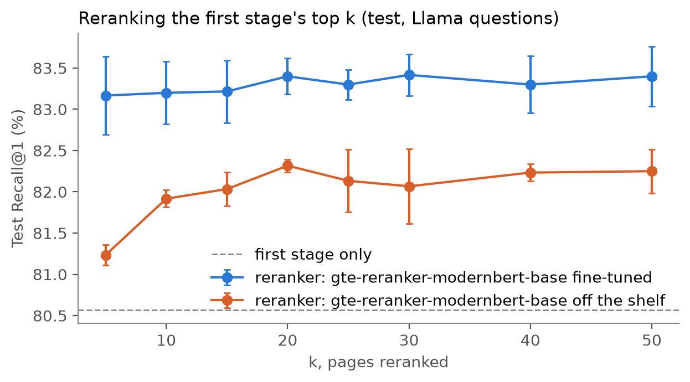

# Scores

Part 1 of [`PLAN.md`](../PLAN.md): which retriever returns the page a person means when they ask about their browsing history in their own words. Each test question ranks its own 200-page history: the answer, 100 BM25 look-alikes of it and 99 random pages. The test set was scored once, after every model choice had been made on validation.

**Result.** The final model, fine-tuned snowflake-arctic-embed-l-v2.0 with a fine-tuned gte-reranker-modernbert-base fused over its top 10, puts the answer first for **83.2%** of the 2,000 Llama test questions (± 0.4 over 3 seeds). That is 27.1 points above BM25, 13.8 above all-MiniLM-L6-v2 and 4.6 above snowflake off the shelf. All three gains hold on the Qwen questions and the keyword queries, and every 95% bootstrap interval excludes zero. Fine-tuning the first stage adds 2.0 points (Llama) to 4.6 (Qwen), and the reranker adds 2.6 more on top. The first stage has the answer in its top 10 for 98.0% of questions and in its top 50 for 99.7%. On a laptop GPU the final model takes about 46 ms per question at k = 10, and 150 ms on the CPU.

## Test results (2,000 questions per set)

Conditions 4 to 7 are mean ± sample std over 3 seeds: first-stage seed s, and in condition 7 reranker seed s. Conditions 1 to 3 have no training, so they have one run. Full per-seed numbers are in `test/test_scores.csv`, and every answer's rank is in `test/answer_ranks.parquet`.

### Llama questions (primary: written by a different LLM from the training questions)

| # | Condition | R@1 | R@5 | R@10 | R@20 | R@50 | R@100 | MRR |
| --- | --- | --- | --- | --- | --- | --- | --- | --- |
| 1 | BM25 | 0.561 | 0.777 | 0.840 | 0.886 | 0.937 | 0.975 | 0.660 |
| 2 | all-MiniLM-L6-v2, off the shelf | 0.694 | 0.894 | 0.946 | 0.973 | 0.991 | 0.998 | 0.785 |
| 3 | snowflake-arctic-embed-l-v2.0, off the shelf | 0.785 | 0.946 | 0.970 | 0.987 | 0.997 | 1.000 | 0.855 |
| 4 | snowflake, fine-tuned | 0.806 ± 0.003 | 0.960 ± 0.001 | 0.980 ± 0.001 | 0.990 ± 0.001 | 0.997 ± 0.000 | 1.000 ± 0.000 | 0.874 ± 0.002 |
| 5 | BM25 + fine-tuned snowflake, RRF | 0.682 ± 0.002 | 0.886 ± 0.002 | 0.934 ± 0.001 | 0.978 ± 0.002 | 0.995 ± 0.000 | 1.000 ± 0.000 | 0.776 ± 0.001 |
| 6 | 4 + gte-reranker-modernbert-base off the shelf, top 10, fused | 0.819 ± 0.001 | 0.962 ± 0.001 | 0.980 ± 0.001 | 0.990 ± 0.001 | 0.997 ± 0.000 | 1.000 ± 0.000 | 0.883 ± 0.001 |
| 7 | **4 + gte-reranker-modernbert-base fine-tuned, top 10, fused (final)** | 0.832 ± 0.004 | 0.963 ± 0.002 | 0.980 ± 0.001 | 0.990 ± 0.001 | 0.997 ± 0.000 | 1.000 ± 0.000 | 0.890 ± 0.002 |

### Qwen questions (the training questions' style)

| # | Condition | R@1 | R@5 | R@10 | R@20 | R@50 | R@100 | MRR |
| --- | --- | --- | --- | --- | --- | --- | --- | --- |
| 1 | BM25 | 0.517 | 0.736 | 0.800 | 0.857 | 0.927 | 0.966 | 0.619 |
| 2 | all-MiniLM-L6-v2, off the shelf | 0.652 | 0.881 | 0.934 | 0.969 | 0.991 | 0.999 | 0.757 |
| 3 | snowflake-arctic-embed-l-v2.0, off the shelf | 0.755 | 0.931 | 0.963 | 0.986 | 0.995 | 1.000 | 0.833 |
| 4 | snowflake, fine-tuned | 0.801 ± 0.004 | 0.960 ± 0.001 | 0.982 ± 0.001 | 0.993 ± 0.001 | 0.997 ± 0.000 | 1.000 ± 0.000 | 0.869 ± 0.002 |
| 5 | BM25 + fine-tuned snowflake, RRF | 0.645 ± 0.005 | 0.863 ± 0.002 | 0.922 ± 0.000 | 0.974 ± 0.001 | 0.996 ± 0.000 | 0.999 ± 0.000 | 0.744 ± 0.003 |
| 6 | 4 + gte-reranker-modernbert-base off the shelf, top 10, fused | 0.807 ± 0.001 | 0.959 ± 0.000 | 0.982 ± 0.001 | 0.993 ± 0.001 | 0.997 ± 0.000 | 1.000 ± 0.000 | 0.874 ± 0.000 |
| 7 | **4 + gte-reranker-modernbert-base fine-tuned, top 10, fused (final)** | 0.821 ± 0.001 | 0.963 ± 0.002 | 0.982 ± 0.001 | 0.993 ± 0.001 | 0.997 ± 0.000 | 1.000 ± 0.000 | 0.883 ± 0.000 |

### Keyword queries (the original ORCAS queries, typed by people)

| # | Condition | R@1 | R@5 | R@10 | R@20 | R@50 | R@100 | MRR |
| --- | --- | --- | --- | --- | --- | --- | --- | --- |
| 1 | BM25 | 0.410 | 0.637 | 0.719 | 0.785 | 0.866 | 0.929 | 0.518 |
| 2 | all-MiniLM-L6-v2, off the shelf | 0.587 | 0.837 | 0.898 | 0.944 | 0.978 | 0.994 | 0.698 |
| 3 | snowflake-arctic-embed-l-v2.0, off the shelf | 0.681 | 0.902 | 0.942 | 0.971 | 0.991 | 0.998 | 0.781 |
| 4 | snowflake, fine-tuned | 0.706 ± 0.005 | 0.928 ± 0.003 | 0.963 ± 0.000 | 0.981 ± 0.001 | 0.994 ± 0.001 | 0.998 ± 0.000 | 0.804 ± 0.003 |
| 5 | BM25 + fine-tuned snowflake, RRF | 0.527 ± 0.001 | 0.784 ± 0.001 | 0.866 ± 0.001 | 0.945 ± 0.002 | 0.992 ± 0.001 | 0.997 ± 0.001 | 0.644 ± 0.001 |
| 6 | 4 + gte-reranker-modernbert-base off the shelf, top 10, fused | 0.719 ± 0.004 | 0.925 ± 0.001 | 0.963 ± 0.000 | 0.981 ± 0.001 | 0.994 ± 0.001 | 0.998 ± 0.000 | 0.811 ± 0.003 |
| 7 | **4 + gte-reranker-modernbert-base fine-tuned, top 10, fused (final)** | 0.730 ± 0.003 | 0.932 ± 0.001 | 0.963 ± 0.000 | 0.981 ± 0.001 | 0.994 ± 0.001 | 0.998 ± 0.000 | 0.818 ± 0.002 |

- **Keyword check (PLAN.md):** the final model does not lose on the keyword queries. It gains 2.4 points of Recall@1 over the fine-tuned first stage alone (0.730 vs 0.706) and 4.8 over snowflake off the shelf.
- **Style gap:** the fine-tuned first stage scores the same on Llama and Qwen questions (0.806 vs 0.801), so it learned the task, not Qwen's style.
- **The hybrid (5) hurts.** RRF gives BM25's ranks equal weight, and BM25 is 25 points worse at Recall@1, so the fusion drags the dense ranking down (−12.4 points against 4 on Llama). Only its Recall@50 stays level.

### Paired bootstrap against conditions 1, 2 and 3

10,000 resamples of the 2,000 questions, the same resamples for every comparison. A seeded condition is first averaged over its 3 seeds for each question. Recall@1 difference in points [95% CI]; n.s. = p ≥ 0.05, two-sided. All the differences in `test/bootstrap.csv` also have p-values.

| Condition | Source | vs 1 (BM25) | vs 2 (MiniLM) | vs 3 (snowflake off the shelf) |
| --- | --- | --- | --- | --- |
| 2 | llama | +13.2 [+11.0, +15.4] |  |  |
| 2 | qwen | +13.5 [+11.2, +15.8] |  |  |
| 2 | keyword | +17.7 [+15.4, +20.1] |  |  |
| 3 | llama | +22.4 [+20.2, +24.6] | +9.2 [+7.4, +11.0] |  |
| 3 | qwen | +23.8 [+21.6, +25.9] | +10.3 [+8.5, +12.2] |  |
| 3 | keyword | +27.2 [+24.9, +29.5] | +9.4 [+7.5, +11.4] |  |
| 4 | llama | +24.5 [+22.3, +26.7] | +11.2 [+9.5, +13.0] | +2.0 [+0.7, +3.4] |
| 4 | qwen | +28.3 [+26.1, +30.6] | +14.9 [+13.0, +16.8] | +4.6 [+3.2, +6.0] |
| 4 | keyword | +29.6 [+27.2, +31.9] | +11.9 [+10.0, +13.8] | +2.4 [+0.9, +4.0] |
| 5 | llama | +12.1 [+10.6, +13.7] | -1.1 [-3.1, +0.9] n.s. | -10.3 [-12.2, -8.5] |
| 5 | qwen | +12.7 [+11.2, +14.3] | -0.7 [-2.9, +1.4] n.s. | -11.0 [-12.9, -9.2] |
| 5 | keyword | +11.7 [+10.2, +13.3] | -6.0 [-8.2, -3.8] | -15.4 [-17.6, -13.2] |
| 6 | llama | +25.8 [+23.7, +27.9] | +12.6 [+10.8, +14.3] | +3.4 [+2.1, +4.7] |
| 6 | qwen | +28.9 [+26.7, +31.1] | +15.5 [+13.7, +17.4] | +5.2 [+3.8, +6.6] |
| 6 | keyword | +30.9 [+28.6, +33.1] | +13.2 [+11.3, +15.0] | +3.7 [+2.2, +5.2] |
| 7 | llama | +27.1 [+24.9, +29.1] | +13.8 [+12.1, +15.6] | +4.6 [+3.3, +6.0] |
| 7 | qwen | +30.4 [+28.1, +32.6] | +16.9 [+15.0, +18.8] | +6.6 [+5.2, +8.1] |
| 7 | keyword | +32.0 [+29.7, +34.3] | +14.3 [+12.4, +16.2] | +4.8 [+3.2, +6.4] |

MRR difference in points [95% CI], conditions 4 and 7:

| Condition | Source | vs 1 | vs 2 | vs 3 |
| --- | --- | --- | --- | --- |
| 4 | llama | +21.4 [+19.7, +23.0] | +8.9 [+7.7, +10.1] | +1.9 [+1.0, +2.7] |
| 4 | qwen | +25.1 [+23.3, +26.8] | +11.3 [+10.0, +12.5] | +3.6 [+2.7, +4.5] |
| 4 | keyword | +28.6 [+26.7, +30.4] | +10.5 [+9.2, +11.9] | +2.3 [+1.4, +3.2] |
| 7 | llama | +23.0 [+21.3, +24.6] | +10.5 [+9.3, +11.7] | +3.5 [+2.6, +4.3] |
| 7 | qwen | +26.5 [+24.7, +28.2] | +12.7 [+11.4, +14.0] | +5.0 [+4.1, +5.9] |
| 7 | keyword | +30.0 [+28.2, +31.9] | +12.0 [+10.7, +13.3] | +3.7 [+2.8, +4.7] |

### Reranker against k (Llama questions)

The reranker reorders the first stage's top k; pages below k keep their first-stage order. "Fused" ranks the top k by `w_bi * z(first stage) + z(reranker)`, with z standardised within each question's top k. `w_bi` is picked for each k and seed on held-out training rows (below), never on validation. "Reranker alone" is `w_bi = 0`. Time is the whole question on the final model: encode the question, score the 200 entries, rerank k pages in one batch, fuse.

| k | First stage R@k | 7 fused R@1 | 7 reranker alone R@1 | 6 fused R@1 | 6 reranker alone R@1 | GPU ms | CPU ms |
| --- | --- | --- | --- | --- | --- | --- | --- |
| 5 | 0.960 ± 0.001 | 0.832 ± 0.005 | 0.828 ± 0.003 | 0.812 ± 0.001 | 0.786 ± 0.002 | 32 | 105 |
| 10 | 0.980 ± 0.001 | 0.832 ± 0.004 | 0.826 ± 0.002 | 0.819 ± 0.001 | 0.782 ± 0.001 | 46 | 150 |
| 15 |  | 0.832 ± 0.004 | 0.826 ± 0.002 | 0.820 ± 0.002 | 0.778 ± 0.000 | 62 | 212 |
| 20 | 0.990 ± 0.001 | 0.834 ± 0.002 | 0.824 ± 0.002 | 0.823 ± 0.001 | 0.775 ± 0.001 | 79 | 277 |
| 25 |  | 0.833 ± 0.002 | 0.823 ± 0.002 | 0.821 ± 0.004 | 0.773 ± 0.000 | 98 | 341 |
| 30 |  | 0.834 ± 0.003 | 0.823 ± 0.003 | 0.821 ± 0.005 | 0.772 ± 0.000 | 117 | 410 |
| 40 |  | 0.833 ± 0.003 | 0.822 ± 0.003 | 0.822 ± 0.001 | 0.771 ± 0.001 | 155 | 521 |
| 50 | 0.997 ± 0.000 | 0.834 ± 0.004 | 0.822 ± 0.003 | 0.823 ± 0.003 | 0.770 ± 0.000 | 195 | 672 |

- k = 10, the final model's k, is already on the plateau: k = 50 adds at most 0.2 points and costs 4× the time.
- Fusion matters most for the off-the-shelf reranker. Alone, it gets worse as k grows (0.786 → 0.770), because it promotes look-alike pages the first stage had rightly ranked low.

### Time per question

One question at a time, from the question text to the ranked 200-entry history. Entry vectors are computed beforehand, since each entry is embedded once, and that cost is the ms-per-entry column. GPU is the Mac's GPU (MPS), with 100 questions per condition; CPU uses 30. Conditions 3 and 4, and 6 and 7, share an architecture, so the fine-tuned seed-0 models were timed. BM25 runs on the CPU only and scores the whole 300k-entry index for each question. For tiny models such as MiniLM the single-question GPU dispatch costs more than the compute, so the CPU is faster.

| # | GPU ms per question | CPU ms per question | GPU ms per entry | CPU ms per entry |
| --- | --- | --- | --- | --- |
| 1 | – | 0.2 | – | – |
| 2 | 8.9 | 2.8 | 0.19 | 0.86 |
| 3 | 16.7 | 37.4 | 3.99 | 17.33 |
| 4 | 16.7 | 37.4 | 3.99 | 17.33 |
| 5 | 14.2 | 37.9 | – | – |
| 6 | 46.0 | 150.1 | – | – |
| 7 | 46.0 | 150.1 | – | – |

MXBAI

| # | Condition | Llama R@1 | Llama R@10 | Llama MRR | Qwen R@1 | Keyword R@1 | Keyword R@50 |
| --- | --- | --- | --- | --- | --- | --- | --- |
| – | mxbai-embed-large-v1, fine-tuned | 0.787 ± 0.004 | 0.976 ± 0.001 | 0.858 ± 0.002 | 0.789 ± 0.003 | 0.688 ± 0.006 | 0.988 ± 0.001 |
| 4 | snowflake, fine-tuned | 0.806 ± 0.003 | 0.980 ± 0.001 | 0.874 ± 0.002 | 0.801 ± 0.004 | 0.706 ± 0.005 | 0.994 ± 0.001 |

WEIGHTS 50000 1293 False
    condition  seed   k  w_bi  w_cross  tune_recall@1  tune_reranker_alone_recall@1  tuned_w_bi                                               source
1           6     0  10  1.00        1       0.778036                      0.707657         NaN                                                  NaN
9           7     0  10  1.25        1       0.781129                      0.766435         NaN                                                  NaN
17          6     1  10  0.80        1       0.776489                      0.706110         NaN                                                  NaN
25          7     1  10  0.60        1       0.786543                      0.767981         NaN                                                  NaN
33          6     2  10  0.80        1       0.773395                      0.706883         NaN                                                  NaN
41          7     2  10  1.00        1       0.792730                      0.760247         0.8  reranker selection (reranker_winner.txt fused_w_bi)

## Decisions made during scoring

- **Fusion weights.** They were picked on 1,000 held-out training rows (pool rows 50,000–51,000 at the drop10 cutoff, 1,293 questions with their keyword queries). Both stages trained only on the first 50,000 rows, so neither model saw these rows. Each row got a pseudo-history built like the test ones, and `w_bi` came from a 14-value grid by Recall@1 (MRR breaks ties). At k = 10 the reranker selection had already fixed the final model's weights (`fused_w_bi` in `reranker_winner.txt`: 1.25, 0.6 and 1.0 for seeds 0 to 2). Condition 7 uses those. The same procedure here gave 1.25, 0.6 and 0.8. Seed 2 was re-scored with 1.0 (Llama Recall@1 0.832 → 0.830). The k curve and condition 6 use the weights picked here (`test/fusion_weights.json`).
- **Reranker candidates.** The rerankers were fine-tuned on mxbai-embed-large-v1's top-k mistakes, because the first stage changed to snowflake after they had trained. They were scored on snowflake's top k without retraining, as the reranker selection did. Retraining on snowflake's mistakes might gain a little more.
- **Sequence length.** Every bi-encoder, including MiniLM and snowflake off the shelf, encodes at 64 tokens, the fine-tuning length. The reranker uses 128 tokens for question and entry together.
- **Seeds.** Reranker seed s is paired with first-stage seed s, so condition 7's spread includes both stages' seed variance.
- Larger reranker experiments from the earlier rounds (MiniLM-L12, Qwen3-Reranker-0.6B and 4B) did not improve results and are not in the tables.

## Model selection (validation)

### First stage

snowflake-arctic-embed-l-v2.0, fine-tuned on 50k rows. Recall@10 and Recall@50 were saturated: all three candidates were within 1 point. So Recall@1, MRR and the keyword queries decided, and snowflake led on all three. All 233k rows gained only 0.4 points, below the 0.5-point rule. Details and the failed attempts are in [`experiments/first-stage-selection.md`](experiments/first-stage-selection.md).

### Reranker (validation, 500 questions per set, Recall@1)

Fine-tuned as sentence-transformers CrossEncoders on 50k rows from mxbai-embed-large-v1's top k (20k for bge-reranker-v2-m3, as planned). mxbai-rerank-large-v1 was screened off the shelf (0.710 at k = 10 on e5's top k) and dropped from training. Final k = 10.

Selection on mxbai's top k (first stage alone 0.760, keyword 0.656):

| Reranker | k=10 | k=20 | k=50 | ms/q (k=10) | Qwen | Keyword | Off the shelf |
|---|---|---|---|---|---|---|---|
| gte-reranker-modernbert-base (seed 0) | **0.804** | 0.802 | 0.800 | 40 | 0.806 | 0.662 | 0.754 |
| bge-reranker-v2-m3 | 0.782 | | | 79 | | 0.658 | 0.770 |

gte won by more than 1 point and is faster. Its seeds 1 and 2 scored 0.802 and 0.812. v2-m3 trained with the cached MNRL loss (mini-batch 16, same gradient), eager attention and batch 16, peaking at 24 GB; at batch 32 it used 74 GB.

On snowflake's top k (the chosen first stage: alone 0.790, keyword 0.682). Rerankers were trained on mxbai's candidates. "Fused" is `w_bi * z(first stage) + z(reranker)` within the top 10, with `w_bi` chosen on 1,000 held-out training rows (pool rows 50k–51k, questions plus keyword queries), never on validation:

| Reranker | Alone | Alone keyword | w_bi | Fused | Fused Qwen | Fused keyword |
|---|---|---|---|---|---|---|
| gte seed 0 | 0.804 | 0.658 | 1.25 | 0.816 | 0.824 | 0.694 |
| gte seed 1 | 0.802 | 0.670 | 0.6 | 0.814 | 0.834 | 0.710 |
| gte seed 2 | 0.810 | 0.680 | 1.0 | 0.818 | 0.826 | 0.716 |
| bge-reranker-v2-m3 | 0.780 | 0.652 | 1.0 | 0.808 | 0.824 | 0.686 |

Without fusion, gte loses to snowflake on keyword queries (0.658 vs 0.682), which breaks PLAN.md's keyword rule. With fusion, all three seeds pass (0.694–0.716), so nothing was retrained. Winner: gte seed 0, fused at k = 10 with w_bi 1.25. The k = 10 cost is about 31 ms per question.

## Appendix

### A. mxbai-embed-large-v1 fine-tuned on test (the first pick, replaced by snowflake)

Same settings as condition 4 (50k rows, look-alike negatives, 3 seeds), 2,000 test questions per set. Snowflake is ahead on every column, which confirms the correction on test.

| # | Condition | Llama R@1 | Llama R@10 | Llama MRR | Qwen R@1 | Keyword R@1 | Keyword R@50 |
| --- | --- | --- | --- | --- | --- | --- | --- |
| – | mxbai-embed-large-v1, fine-tuned | 0.787 ± 0.004 | 0.976 ± 0.001 | 0.858 ± 0.002 | 0.789 ± 0.003 | 0.688 ± 0.006 | 0.988 ± 0.001 |
| 4 | snowflake, fine-tuned | 0.806 ± 0.003 | 0.980 ± 0.001 | 0.874 ± 0.002 | 0.801 ± 0.004 | 0.706 ± 0.005 | 0.994 ± 0.001 |

### B. Off-the-shelf screening (validation)

From [`experiments/screening/screening.md`](experiments/screening/screening.md).

#### First stage

Llama questions; keyword Recall@50 in the last column. BM25 times are on the CPU, the others on the GPU.

| Model | R@1 | R@5 | R@10 | R@20 | R@50 | R@100 | MRR | ms/entry | ms/question | Keyword R@50 |
|---|---|---|---|---|---|---|---|---|---|---|
| bm25 | 0.522 | 0.766 | 0.832 | 0.884 | 0.938 | 0.976 | 0.632 | 0.011 | 0.2 | 0.870 |
| all-MiniLM-L6-v2 | 0.672 | 0.896 | 0.952 | 0.974 | 0.994 | 0.996 | 0.776 | 0.325 | 7.6 | 0.984 |
| bge-base-en-v1.5 | 0.734 | 0.934 | 0.970 | 0.982 | 0.994 | 1.000 | 0.826 | 1.432 | 11.5 | 0.988 |
| bge-large-en-v1.5 | 0.742 | 0.942 | 0.968 | 0.980 | 0.996 | 0.998 | 0.832 | 4.439 | 24.5 | 0.992 |
| mxbai-embed-large-v1 | 0.752 | 0.958 | 0.978 | 0.986 | 0.996 | 0.998 | 0.838 | 1.443 | 21.3 | 0.990 |
| e5-large-v2 | 0.730 | 0.944 | 0.966 | 0.986 | 0.998 | 0.998 | 0.822 | 4.605 | 23.0 | 0.992 |
| snowflake-arctic-embed-l-v2.0 | 0.774 | 0.942 | 0.972 | 0.982 | 0.992 | 0.996 | 0.848 | 4.459 | 13.5 | 0.990 |
| Qwen3-Embedding-0.6B | 0.712 | 0.908 | 0.946 | 0.974 | 0.992 | 1.000 | 0.803 | 3.008 | 16.1 | 0.984 |

#### Rerankers on the top k of e5-large-v2

Llama questions, reranker score alone; keyword Recall@1 in the last column. GPU time per question, k pairs in one batch.

| Reranker | k | R@1 | R@5 | MRR | ms/question | Keyword R@1 |
|---|---|---|---|---|---|---|
| ms-marco-MiniLM-L6-v2 | 10 | 0.722 | 0.930 | 0.810 | 6 | 0.584 |
| ms-marco-MiniLM-L6-v2 | 20 | 0.724 | 0.916 | 0.809 | 8 | 0.582 |
| ms-marco-MiniLM-L6-v2 | 50 | 0.724 | 0.912 | 0.806 | 17 | 0.580 |
| bge-reranker-base | 10 | 0.684 | 0.908 | 0.791 | 22 | 0.580 |
| bge-reranker-base | 20 | 0.670 | 0.904 | 0.777 | 41 | 0.570 |
| bge-reranker-base | 50 | 0.662 | 0.892 | 0.766 | 106 | 0.554 |
| gte-reranker-modernbert-base | 10 | 0.754 | 0.936 | 0.832 | 30 | 0.632 |
| gte-reranker-modernbert-base | 20 | 0.748 | 0.932 | 0.828 | 55 | 0.632 |
| gte-reranker-modernbert-base | 50 | 0.746 | 0.918 | 0.822 | 145 | 0.620 |
| bge-reranker-v2-m3 | 10 | 0.770 | 0.942 | 0.846 | 66 | 0.622 |
| bge-reranker-v2-m3 | 20 | 0.762 | 0.938 | 0.841 | 132 | 0.618 |
| bge-reranker-v2-m3 | 50 | 0.760 | 0.936 | 0.838 | 348 | 0.618 |
| Qwen3-Reranker-0.6B | 10 | 0.748 | 0.944 | 0.837 | 162 | 0.614 |
| Qwen3-Reranker-0.6B | 20 | 0.746 | 0.942 | 0.836 | 304 | 0.612 |
| Qwen3-Reranker-0.6B | 50 | 0.746 | 0.938 | 0.835 | 757 | 0.608 |
| mxbai-rerank-large-v1 (CPU time) | 10 | 0.710 | 0.938 | 0.810 | 608 | 0.578 |
| mxbai-rerank-large-v1 (CPU time) | 20 | 0.692 | 0.936 | 0.799 | 1138 | 0.574 |
| mxbai-rerank-large-v1 (CPU time) | 50 | 0.682 | 0.920 | 0.790 | 2779 | 0.570 |

mxbai-rerank-large-v1 was screened later on the CPU (the GPU was busy), loaded in float32, on the same 500 validation
questions and the top k of e5-large-v2 recomputed on the CPU (Llama Recall@1 0.728, Recall@10 0.966, Recall@50 0.998,
against 0.730, 0.966 and 0.998 on the GPU). Its ms/question is CPU time and is not comparable with the GPU rows.

### C. Earlier exploratory rounds (first, paraphrase prompt)

These used questions from the first prompt, which forbade copying title words. They are not comparable with the tables above.

#### Validation, Llama questions (500)

| Model | Recall@1 | Recall@5 | MRR |
|---|---|---|---|
| BM25 | 0.476 | 0.708 | 0.582 |
| bge-small, off the shelf | 0.654 | 0.896 | 0.764 |
| BM25 + bge-small, RRF hybrid | 0.550 | 0.816 | 0.675 |
| bge-small fine-tuned, all rows, hard negatives (seed 0) | 0.692 | 0.892 | 0.785 |
| bge-small fine-tuned, lowest 10% train_score dropped, hard negatives (seed 0) | 0.694 | 0.898 | 0.786 |

#### Test (2,000 per source)

| Model | Llama R@1 | Llama R@5 | Qwen R@1 | Qwen R@5 | Keyword R@1 | Keyword R@5 |
|---|---|---|---|---|---|---|
| BM25 | 0.486 | 0.717 | 0.478 | 0.700 | 0.410 | 0.637 |
| bge-small, off the shelf | 0.676 | 0.896 | 0.644 | 0.874 | 0.591 | 0.842 |
| BM25 + bge-small, RRF hybrid | 0.580 | 0.818 | 0.568 | 0.800 | 0.462 | 0.742 |

Fine-tuned models have no test scores yet: training was stopped after two selection runs to revise the approach.

#### Experiments (validation, Llama questions; 50k training rows, bf16, seed 0)

Each experiment changes one thing from `baseline-50k`. Full settings and numbers are in `results/experiments/<name>/validation.json`.

| Experiment | Recall@1 | Recall@5 | MRR |
|---|---|---|---|
| baseline-50k (question BM25 negative, lr 2e-5, 1 epoch, batch 128) | 0.690 | 0.902 | 0.783 |
| url-words (URL split into words) | 0.682 | 0.894 | 0.780 |
| lookalike-negatives (1 look-alike of the positive page) | **0.708** | **0.920** | 0.798 |
| lookalike-negatives-3 (3 look-alikes) | **0.708** | 0.918 | **0.800** |
| train-harder-ep, lr 5e-5, epoch 1 / 2 / 3 | 0.676 / 0.670 / 0.668 | 0.898 / 0.888 / 0.896 | 0.773 / 0.771 / 0.767 |
| train-harder-batch, lr 1e-4, batch 1024 cached loss, epoch 1 / 2 / 3 | 0.692 / 0.690 / 0.694 | 0.906 / 0.908 / 0.904 | 0.787 / 0.788 / 0.789 |

With url-words, BM25 rose to 0.486 / 0.714 / 0.595 and off-the-shelf bge-small to 0.668 / 0.892 / 0.771.
